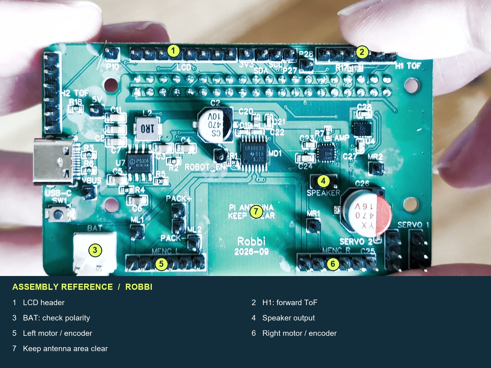
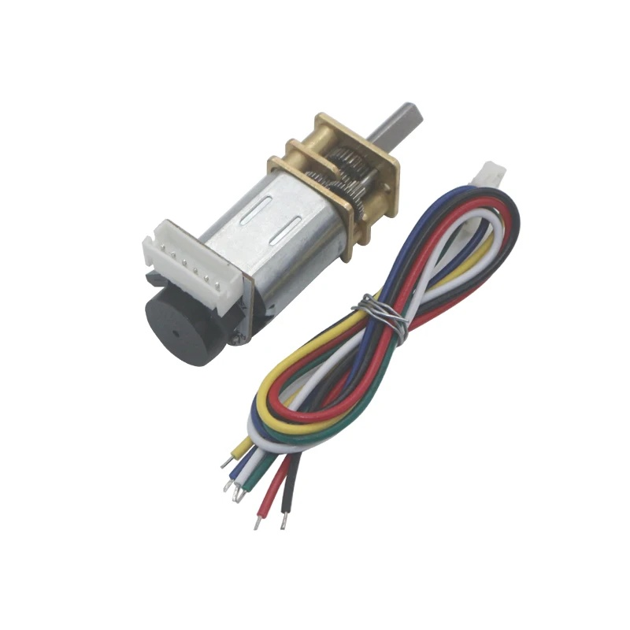
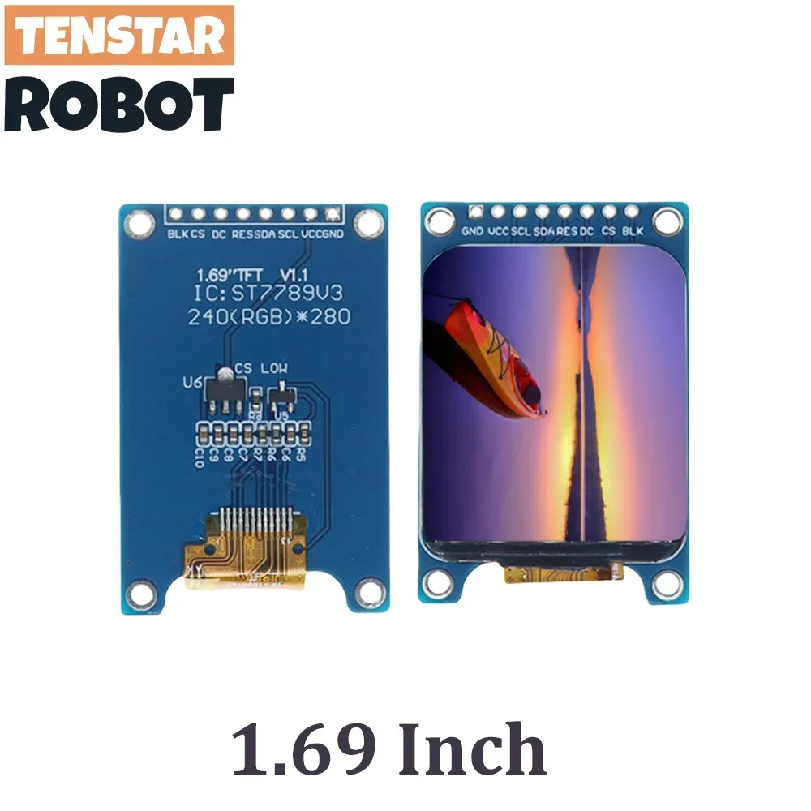
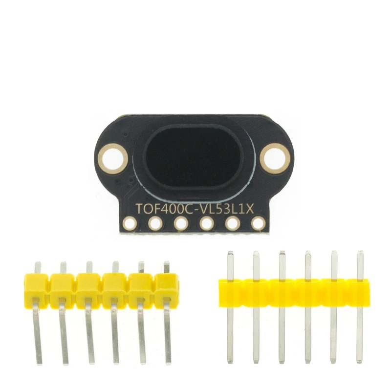
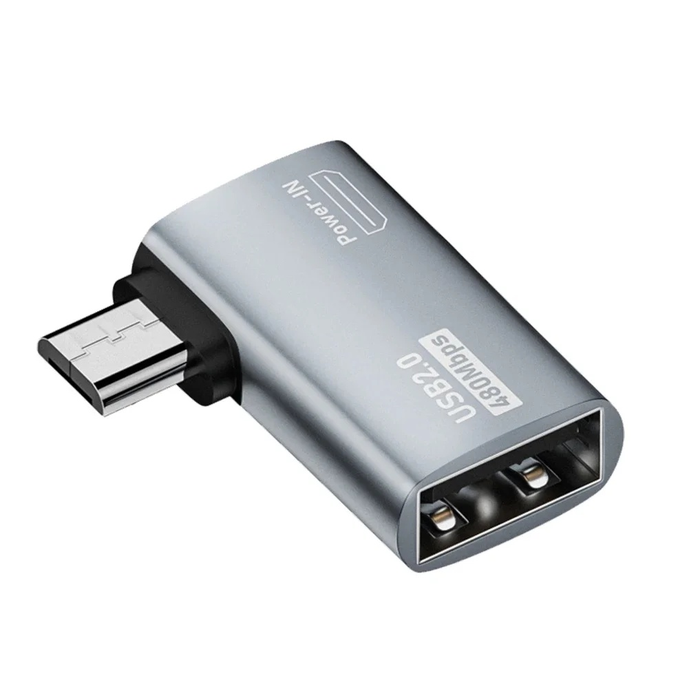
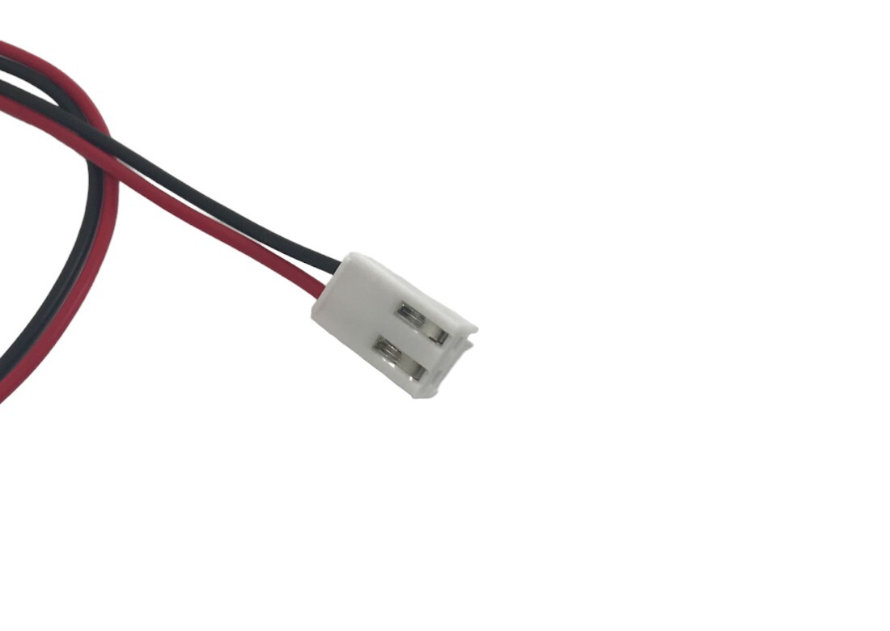
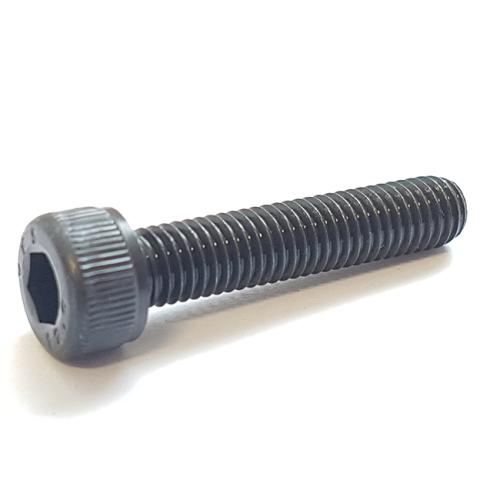

# 1. Choose the parts

[Guide home](README.md) · [Preparation →](02-preparation.md)

Match the PCB, enclosure and motor revisions before ordering. Choose the exact variants below; a listing may open with a different option selected. Purchase links below lead to AliExpress, except the official Raspberry Pi page. New reference listings were found through indexed product pages; live stock, seller authenticity and delivery to your country have not been verified. Confirm the exact variant before ordering.

**Custom board:** order one assembled board from the approved release, with matching Gerbers, assembly BOM and placement file. The board already carries the motor driver, amplifier, IMU and power electronics. Separate DRV8833, MAX98357A, IMU, charger or boost breakout boards are not additions to this custom-PCB build. Confirm which through-hole connectors the assembler fits; the supplied BOM marks the underside 40-pin socket for hand soldering. Use the [current manufacturing package and ordering notes](hardware/pcb/README.md); remaining electrical documentation is listed in [the release checklist](RELEASE-CHECKLIST.md).

## Order list

| Qty | Part | Exact choice | Purchase link |
|---|---|---|---|
| 1 | Assembled Robbi custom PCB | Custom four-layer board  •  Fabrication + component assembly  •  Quote required | [AliExpress · quote](https://www.aliexpress.com/item/1005012242415880.html) |
| 1 | Raspberry Pi Zero 2 W | 1 board  •  Wi-Fi  •  Header already soldered | [Raspberry Pi](https://www.raspberrypi.com/products/raspberry-pi-zero-2-w/) |
| 1 | High-quality microSD card | 32 GB minimum  •  64 or 128 GB recommended  •  A1 or A2  •  Class 10 / UHS-I | [AliExpress](https://www.aliexpress.com/item/1005012331420695.html) |
| 2 | N20 motors with encoders | 2 matching motors  •  3 V  •  75 RPM  •  Encoders | [AliExpress](https://de.aliexpress.com/item/4001275879836.html) |
| As required | MR128ZZ miniature bearings | MR128ZZ  •  8 mm bore  •  12 mm outside  •  3.5 mm thick | [AliExpress](https://de.aliexpress.com/item/32962032067.html) |
| 1 | TOF400C-VL53L1 sensor | 1 module  •  Select TOF400C-VL53L1 | [AliExpress](https://de.aliexpress.com/item/1005007318361593.html) |
| 1 | TENSTAR ROBOT SPI display | 1 display  •  1.69 inch  •  240 × 280  •  8 pins | [AliExpress](https://de.aliexpress.com/item/1005007346976745.html) |
| 1 | IMX219 wide-angle camera | 1 camera  •  IMX219  •  130° or 160° lens  •  CSI | [AliExpress](https://www.aliexpress.com/item/33015616449.html) |
| 1 | 20 mm miniature speaker | 1 speaker  •  20 mm diameter  •  8 Ω / 8R  •  0.5 W | [AliExpress](https://de.aliexpress.com/item/1005006344913948.html) |
| 1 | 18650 holder with wires | 1 holder  •  Single cell  •  With wires | [AliExpress](https://de.aliexpress.com/item/1005006089547043.html) |
| 1 | 18650 rechargeable cell | 1 cell  •  About 3000 mAh  •  Genuine high-drain Li-ion | [AliExpress](https://www.aliexpress.com/item/1005013171674610.html) |
| 1 | USB-C 18650 charger | 1 charger  •  External slot charger  •  USB-C input | [AliExpress](https://www.aliexpress.com/item/1005008944009834.html) |
| 1 | Micro-USB OTG adapter — LEFT | 1 adapter  •  LEFT  •  Micro-USB male → USB-A female | [AliExpress](https://de.aliexpress.com/item/1005006212943594.html) |
| 1 | Mini USB microphone | 1 microphone  •  USB-A  •  Built-in microphone | [AliExpress](https://de.aliexpress.com/item/1005006769901138.html) |
| 1 | VH3.96 battery connector | 1 cable  •  VH series  •  3.96 mm pitch  •  2P | [AliExpress](https://de.aliexpress.com/item/1005002158441860.html) |
| As required | M2 heat-set inserts | M2 internal thread  •  Outside size must match the model | [AliExpress](https://de.aliexpress.com/item/1005009464952378.html) |
| As required | M2 screws and nuts | M2  •  Lengths and quantities follow the assembly files | [AliExpress](https://de.aliexpress.com/item/1005007159750547.html) |
| As required | M3 × 14 mm screws | Additional linked hardware  •  M3  •  14 mm  •  50-piece pack | [AliExpress](https://de.aliexpress.com/item/4000978466742.html) |
| As required | Female-to-female jumper wires | F–F  •  Sockets at both ends  •  2.54 mm headers | [AliExpress](https://de.aliexpress.com/item/1005003641187997.html) |
| 1 | 16 cm Pi Zero camera adapter ribbon | 16 cm; 22-pin / 0.5 mm pitch to 15-pin / 1.0 mm pitch | [AliExpress](https://de.aliexpress.com/item/1005006739911403.html) |
| Assortment | Heat shrink or insulation tape | Small assortment / one roll  •  Electrical insulation | [AliExpress](https://www.aliexpress.com/item/1005010654501775.html) |
| Access to 1 set | Soldering equipment | Use an existing setup or buy one  •  Electronics soldering | [AliExpress](https://www.aliexpress.com/item/1005012288641627.html) |
| 1 set | Precision screwdriver and bits | 1 set  •  Hex H1.5 / H2.0 / H2.5  •  Small Phillips bits | [AliExpress](https://www.aliexpress.com/item/1005013263451955.html) |
| Access to 1 set | Hot glue and glue gun | Access to a glue gun  •  Matching glue sticks | [AliExpress](https://www.aliexpress.com/item/1005013027427882.html) |
| 1 complete print set | 3D printing access or service | One complete set of Robbi’s printed parts  •  Custom quote required | [AliExpress · quote](https://www.aliexpress.com/item/1005012896821394.html) |

“As required” means the count depends on the assembly; pack sizes are not the number used in one robot. Confirm hardware quantities and screw lengths from the released assembly files. For the custom PCB, use the [manufacturing package](hardware/pcb/README.md) and request a quote for four-layer fabrication and assembly; the service listing is not a ready-made Robbi board.

Also provide a suitable USB power source/cable for the isolated Pi setup, a microSD reader, a multimeter and the hand tools in [preparation](02-preparation.md). Battery-lead protection and PCB spacing hardware must be specified in the release; they are not optional omissions just because their exact parts are unresolved.

## Recognise the important variants

| Motor and cable | Display pin labels | Forward ToF |
|---|---|---|
|  |  |  |
| Select **3 V / 75 RPM**, two motors, with cables. | Select **240 × 280, eight pins**. Match signals when wiring; VCC/GND differ from the custom PCB's order. | Select **TOF400C-VL53L1X**. Keep the optical opening unobstructed. |

| OTG adapter | Battery cable contact type | M2 screw head |
|---|---|---|
|  |  |  |
| **Left-angle**, data-capable. | **VH3.96, 2-pin, female socket contacts**, with leads. | **Cylindrical socket head**, not countersunk. M3 screws are **14 mm long**; 50 is the pack count. |

The reference pictures identify shape and pin labels. For voltage, speed, size and quantity, use the order table above.

## Check deliveries before building

- Count two matching **3V75RPM encoder motors** and their matching cables. Check the label and rear encoder board, not just the product title.
- Confirm **Zero 2 W**, with the 40-pin header already soldered.
- Confirm the **1.69-inch, eight-pin, 240 × 280 SPI display** and the exact ToF board outline.
- Check the camera ribbon: use **16 cm** with different widths at its two ends.
- Check the battery plug: **VH3.96, 2-pin, female socket contacts**, and matching polarity.
- Check screws by their actual dimensions. **M3 × 14 mm** and **M2 socket head** are the required selections. The purchased assortments do not establish the number or M2 length used at each mounting point.
- Keep cells and all power leads disconnected while checking fit.

## Selection details

Expand the component-by-component buying notes

### Raspberry Pi Zero 2 W

The exact Zero 2 W model, with Wi-Fi and the 40-pin GPIO header already installed and soldered. Ask for 已焊接排针; a loose header in the box is not enough.

**Avoid:** The older Zero W / Zero WH, an unsoldered board, or a listing labelled only “Zero 2” without confirmation of Wi-Fi and the exact model.

### High-quality microSD card

Choose a **high-quality microSD card with at least 32 GB**. **64 or 128 GB is recommended** for extra room. Look for A1 or A2 and Class 10 / UHS-I; no particular brand is required. Buy from a reputable seller. The linked card is an example, not a brand requirement. The small microSD card goes into the Pi; an SD adapter is optional for your computer.

**Avoid:** Full-size SD cards, an empty adapter, unbranded cards or suspiciously cheap counterfeits. Advertised reader speeds are not the speed you will get on the Pi.

### N20 motors with encoders

Select “3V75RPM”. Buy two identical N20 / JGA12-N20 units with rear encoder boards. Confirm matching encoder cables are included.

**Avoid:** Plain N20 motors without encoders; 6 V or 12 V versions; 750 RPM, 150 RPM or another speed.

### MR128ZZ miniature bearings

Select “MR128ZZ 8x12x3.5mm”. Check all three dimensions: 8 mm inner diameter, 12 mm outer diameter and 3.5 mm width. The linked listing sells a 10-piece pack; use the assembly instructions for the number needed.

**Avoid:** MR128-2.5 (only 2.5 mm thick), MR148ZZ (14 mm outside), open or rubber-sealed variants, or flanged bearings in place of this plain MR128ZZ.

### TOF400C-VL53L1 sensor

Choose “TOF400C-VL53L1”. Look for the TOF400C-VL53L1X board marking. Match its outline, mounting holes and pin labels; check whether headers arrive soldered.

**Avoid:** TOF050C / VL6180 or TOF200C / VL53L0X. Another VL53L1X module can have a different board shape and pinout.

### TENSTAR ROBOT SPI display

Select “1.69 Inch”. Look for the eight-pin SPI board, ST7789-family controller and 240(RGB) × 280 marking on the display board.

**Avoid:** 1.54-inch or 1.9-inch variants; 240 × 240 or 240 × 320 panels; a different pin count or interface. Ignore the listing’s incorrect automatic 320 × 240 summary.

### IMX219 wide-angle camera

An IMX219 camera with a 130° or 160° lens and Raspberry Pi CSI support. Check board size, mounting holes and lens clearance against the printed mount.

**Avoid:** OV5647 / 5 MP cameras, narrow-angle lenses, USB webcams or bulky IR assemblies that do not fit the mount.

### 20 mm miniature speaker

Select “20mm”, and verify 8R / 8 Ω and 0.5 W. Prefer attached leads; check that the plug matches the build or can be reterminated.

**Avoid:** 23 / 28 / 30 / 36 mm or larger versions, 4 Ω speakers, buzzers or powered USB speakers.

### 18650 holder with wires

Select “1 Section with line”. Check the holder’s outside dimensions against the printed enclosure and its supported cell length.

**Avoid:** The version without wires, a two- to four-cell holder, or an AA / 14500 holder. A holder alone is not a charger.

### 18650 rechargeable cell

A traceable genuine single 18650 Li-ion cell with dimensions, charge/discharge limits and protection compatible with the approved power circuit. Molicel P30B is a reference example, not an instruction to fit an unprotected cell to an unverified circuit.

**Avoid:** Anonymous cells with implausible capacity labels, reclaimed cells, 21700 / 14500 sizes or LiFePO₄. A longer protected/button-top cell may not fit.

### USB-C 18650 charger

A USB-C charger for 3.6 / 3.7 V Li-ion 18650 cells, charging to 4.2 V. Check the actual input socket and use a charge current within the cell manufacturer’s limit. The linked XTAR ANT MC1 Plus is a USB-C reference example.

**Avoid:** An older micro-USB version, a bare TP4056 board, an empty holder, or a charger intended only for NiMH or 1.5 V batteries.

### Micro-USB OTG adapter — LEFT

Choose “Left” in the original listing. It must support OTG and data. For other sellers, check that the plug direction leaves the microphone inside the body with the USB data port accessible.

**Avoid:** “Right”, USB-C, mini-USB or charge-only adapters. Left/right naming can vary between sellers.

### Mini USB microphone

A complete microphone dongle with driver-free USB Audio / Linux / Raspberry Pi compatibility. Match the small physical size shown.

**Avoid:** A USB Bluetooth receiver, a sound card with only empty audio sockets, a 3.5 mm-only mic, or an I²S microphone breakout.

### VH3.96 battery connector

Select “2P”. Buy the VH3.96 housing with crimped wires attached; the linked listing offers 20 cm leads. Check the latch, mating socket and polarity against the PCB. Required cable end is FEMALE, with recessed socket contacts and no exposed pins. Verify polarity with a meter; wire colour alone is insufficient.

**Avoid:** 3P–10P, a bare housing, or a PCB header alone. PH2.0, XH2.50 / 2.54 and other “JST 2-pin” families are not interchangeable.

### M2 heat-set inserts

M2 inserts intended for heat installation. Match outer diameter, length and quantity to the printed parts. The linked assortment contains several sizes, including M2.

**Avoid:** M2.5 / M3 inserts, ordinary hex nuts or wood inserts. “M2” specifies only the thread; it does not guarantee the outside dimensions fit.

### M2 screws and nuts

Choose the M2 option (“482pcs M2” in the linked listing). Check required screw lengths and head style against the assembly instructions; the pack count is not the robot’s screw count. Use cylindrical socket-head screws, not countersunk. Final lengths and quantities remain to be supplied.

**Avoid:** M2.5 / M3 kits by mistake, self-tapping screws, or screws that are too long for the mounting position.

### M3 × 14 mm screws

Select “M3 50 pcs” and “x14mm”. These are socket-head machine screws. Keep this item separate from the M2 screws and inserts. The length is 14 mm. Fifty is the pack count, not a length or build quantity.

**Avoid:** Using M3 screws in M2 threads, or confusing 14 mm length with an M14 thread. Fifty pieces is the selected pack size, not a confirmed build quantity.

### Female-to-female jumper wires

Choose F-F / Female-Female / 母对母. Both ends must have sockets. Select a length and wire count that suit the wiring route without tension.

**Avoid:** M-M / 公对公 or M-F / 公对母. The listing’s default selection may be the wrong type.

### 16 cm Pi Zero camera adapter ribbon

Use a 16 cm Pi Zero adapter ribbon, with a 22-pin narrow end and a 15-pin wide end. Check both connector widths and contact orientation; do not buy 15-to-15 or 22-to-22 by mistake.

**Avoid:** A different length or connector type without checking the fit. Verify that the selected listing option is 16 cm.

### Heat shrink or insulation tape

Heat-shrink sizes that fit over the joints and shrink snugly, or tape explicitly rated for electrical insulation. No particular brand is required.

**Avoid:** Packing tape, masking tape, conductive copper tape, or tubing too large to grip after shrinking.

### Soldering equipment

A temperature-controlled iron, suitable tip, stand, solder wire and electronics flux. Choose a plug and input voltage suitable for your local mains supply.

**Avoid:** 110 V-only equipment, plumbing acid flux, a welding machine, or a hot-air-only tool in place of an electronics soldering iron.

### Precision screwdriver and bits

Check the bit list includes H1.5 and H2.5 hex bits: the DIN 912 socket-head screws shown use 1.5 mm hex for M2 and 2.5 mm for M3. H2.0 and small Phillips bits make the set more versatile. Match the bit to the actual screw head.

**Avoid:** Phillips-only or Torx-only sets, kits missing the small hex sizes, or a large powered driver that can strip these tiny screws.

### Hot glue and glue gun

Glue sticks whose diameter matches the gun. If buying a mains gun, choose a plug and voltage suitable for your local mains supply. Check whether sticks are included.

**Avoid:** Sticks in the wrong diameter, or ordering only a gun when you also need glue. Do not substitute superglue or conductive adhesive without checking the assembly.

### 3D printing access or service

Send the confirmed printable parts, quantities, scale, material and settings for a custom quote. Agree the printing process and tolerances before ordering. The listing price is not the cost of a full Robbi print set. Use the [printing notes](hardware/prints/README.md) to prepare the files; the complete assembly STL is not a single printable part.

**Avoid:** A random robot shell, resized parts or an incomplete print order. Check compatibility before changing material or printing process.

