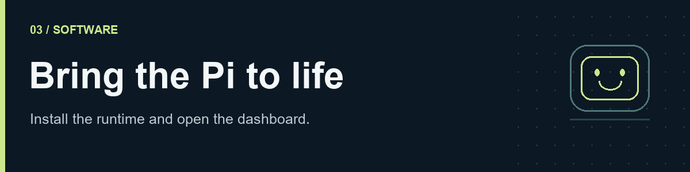

# 3. Install the software



[Guide home](README.md) · [← Preparation](02-preparation.md) · [Bench tests →](04-bench-tests.md)

**Early version, for experienced makers.** Expect tinkering, fixes and several hours of work. Hardware, components and software will change; backward compatibility is not guaranteed. Provided as-is.

The installer is hosted at [ace-builder/Robbi](https://github.com/ace-builder/Robbi). **The runtime release is awaiting publication while its assets are being prepared.** Until that release exists, the hosted installer exits with an explanation and makes no system changes. It does not download private robot code.

## 1. Prepare the microSD card

Use [Raspberry Pi Imager](https://www.raspberrypi.com/software/) to select **Raspberry Pi OS (Legacy) Lite, 64-bit, Bookworm** for a **Pi Zero 2 W**. Check the codename: Trixie/Python 3.13 is not supported by this runtime yet. Set your own Linux username/password or SSH key, hostname (for example `robbi`), Wi-Fi country, **2.4 GHz** Wi-Fi and SSH in Imager. Initial networking must work before you can connect over SSH.

Boot the Pi separately on its normal USB supply with the custom board and motors disconnected. From your computer:

```sh
ssh YOUR_USER@robbi.local
```

Use the address from your router if `.local` does not resolve. Imager documentation: [first boot and remote access](https://www.raspberrypi.com/documentation/computers/getting-started.html).

## 2. Run the installer

Run as your normal Linux user, **without `sudo` in front of the command**. The installer requests sudo for system packages, device access and the service.

```sh
curl -fsSL --proto '=https' --tlsv1.2 https://raw.githubusercontent.com/ace-builder/Robbi/main/install.sh -o /tmp/robbi-install.sh && bash /tmp/robbi-install.sh
```

To inspect it first, download the file, read it, then run `bash /tmp/robbi-install.sh`. A future tagged release can be selected with `--version TAG`. `--plan` describes the steps without installing; with the hosted script it still requires a downloadable runtime. An unpacked, audited release can be used with `bash install.sh --source /path/to/release/robbi-v2`.

The installer verifies SHA-256, checks archive paths and a per-file manifest, installs apt dependencies, and creates `~/robbi-v2/.venv` using the OS camera and numerical libraries. It refuses unsupported systems and unrelated existing installations. Rerunning the **same release** resumes completed steps. This is a fresh-install command, not an updater for a working robot.

Checksums detect corruption; trust still comes from the repository/release publisher. Review the script and release you choose.

## 3. Answer the short setup prompts

1. Enter the name Robbi should use for you. Your Linux login remains the account created in Imager.
2. Choose a dashboard password, or press Enter for a generated one and save it; disabling sign-in requires explicitly trusting every device on the network.
3. Keep the current Wi-Fi, or save another Personal network for the next reboot. The wizard checks the **current** connection; it cannot prove the new password works without joining that network. It never switches your active SSH connection.
4. Select OpenAI, OpenRouter or an OpenAI-compatible local LLM server, edit the model ID, and paste your own key at the hidden prompt. The suggested model is `gpt-6-luna`; account access must pass the test. Local inference runs on another machine, not the Zero 2 W. STT/TTS default to OpenAI; optionally configure your own ElevenLabs voice and model (suggested `eleven_v4`). OpenRouter chat does not provide OpenAI speech credentials.
5. Optionally send one small billable LLM test request. Failure or missing keys does not block the dashboard; configure them later in dashboard **Settings → Connections & API keys** or with `robbi-setup`.
6. Optionally configure Telegram: create a bot with `@BotFather` (`/newbot`), find your numeric ID using `@userinfobot` (`/start`), then enter that ID and your bot token in the wizard. Only your private chat is allowed; photos and robot actions default off. Never send your bot token to the ID bot.
7. Review the interface checks and open the printed dashboard URL. Reboot once when prompted with `sudo reboot`.

The connection test uses the same [Chat Completions API](https://developers.openai.com/api/reference/resources/chat/subresources/completions/methods/create) and JSON response mode as Robbi's conversation path. It sends only a fixed test prompt, never stored conversations, photos or recordings.

## 4. Finish in the dashboard

The service starts on boot and normally serves `http://robbi.local:8082`. Fresh installs require a dashboard password (username `robbi`). Set it in the wizard or later in **Settings → Dashboard access**; existing explicit trusted-LAN settings are preserved. Hardware probes tolerate missing peripherals. Check Overview, test the camera/display/audio and single front ToF, then follow IMU and wheel calibration in the build guide. The installer does not move the wheels. Motors, autonomous tasks and voice listening start disabled. Enroll your own “Hey Robbi” samples before enabling voice.

Use **Settings → Connections & API keys** for provider keys, arbitrary model IDs, local/OpenAI-compatible endpoints and Tavily search. In **Wake word**, record positive, negative and noise examples, then choose **Train in this browser** for lightweight personal calibration. Full neural-model training remains a separate computer workflow; export/import is available in the advanced section.

Everyday setup belongs in the dashboard. There is one configuration, **`~/robbi-v2/config/robot.yaml`**, and one automatically generated service. There is no separate service profile, commissioning profile or browser edition of the manual.

The public build has no automatic training recorder. Memories, conversations, maps, saved photos and app data start empty. Configure your own wake-word reference in the dashboard; private voice samples are not bundled.

## Reconfigure, diagnose or recover

```sh
robbi-setup
systemctl status robbi-v2.service --no-pager
journalctl -u robbi-v2.service -n 80 --no-pager
sudo systemctl restart robbi-v2.service
```

Secrets are written only on your Pi to `~/robbi-v2/.env.secrets`, readable by the owner (mode 0600). They are not put in YAML, shell history or service arguments. Never upload that file, `var/`, Wi-Fi profiles or recordings. Wi-Fi uses a root-only [NetworkManager keyfile](https://networkmanager.dev/docs/api/latest/nm-settings-keyfile.html); only Personal networks are supported by the wizard. Configure enterprise networks through the OS.

Fresh installs select `hardware.right_encoder_b_pin: 16` for the standard board. Alternate wiring can select `7`; this reserves Servo 1. Verify the pin routed by your PCB before motor tests. The public core also defaults to GPIO16 when the field is absent. When migrating alternate wiring, explicitly set the pin that matches that board.

The installer backs up changed boot settings next to `/boot/firmware/config.txt` and a replaced unit next to `/etc/systemd/system/robbi-v2.service`. Its interface block enables I²C, SPI0/CE0, camera detection and `max98357a,no-sdmode`; plain `max98357a` conflicts with a motor pin and is rejected. [Official overlay definitions](https://github.com/raspberrypi/firmware/blob/master/boot/overlays/README).

To stop startup: `sudo systemctl disable --now robbi-v2.service`. To restore it: `sudo systemctl enable --now robbi-v2.service`. Restore the saved boot configuration only if you need to undo interface changes, then reboot. The setup Wi-Fi file is `/etc/NetworkManager/system-connections/robbi-setup.nmconnection`; preserve a known-working network before removing it. Back up configuration, secrets and `var/` before any later upgrade; the fresh installer will not replace an unrelated installation.

A fresh Bookworm SD-card installation and an independent builder run remain release acceptance checks. Automated tests do not establish physical wiring, battery, motor or thermal performance.

**Ready for the bench:** the isolated Pi boots and its dashboard opens. Shut down with `sudo shutdown -h now`, remove USB power, then continue to [Bench tests](04-bench-tests.md).

Imported App Hub/ZIP apps require Linux isolation. The installer adds `bubblewrap` and `libseccomp2`; existing installations can add them with `sudo apt install bubblewrap libseccomp2`. If isolation is unavailable, imported apps stay blocked while bundled apps and the dashboard remain usable.
