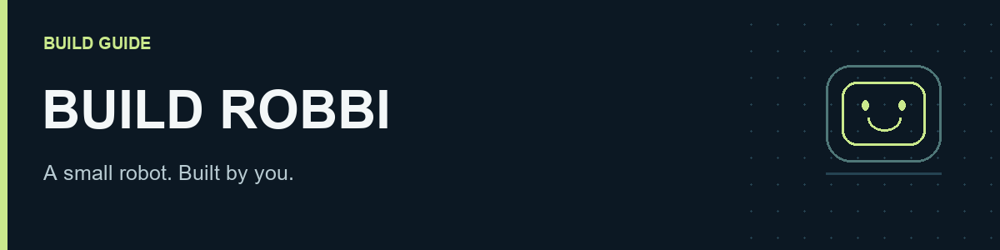
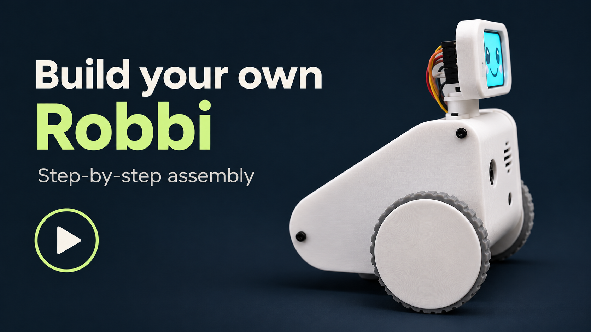

# Build Robbi

A small Raspberry Pi robot with a face, a camera, a voice and two encoder-equipped wheels. Build the electronics on the bench, fit them into the printed body, then bring Robbi's movement and conversation to life.

## Watch the build

**11:46 · 4K · silent, with on-screen instructions.** Follow the assembly in the video and use the written steps below for parts, wiring and calibration.

[Bench tests](https://youtu.be/MBummcW5DIk?t=59) · [Motors and wheels](https://youtu.be/MBummcW5DIk?t=136) · [Head assembly](https://youtu.be/MBummcW5DIk?t=305) · [Final checks](https://youtu.be/MBummcW5DIk?t=626)

> [!IMPORTANT]
> **Build guide in progress.** Includes the parts and variant photos, manufactured PCB settings, connector pinout, assembly STL and illustrated build sequence. Remaining gaps are the tested print recipe, exact fasteners at each mounting point, motor-cable identification and measured power/load limits. See the [release checklist](RELEASE-CHECKLIST.md).

## Start here

Follow the order below. **Finish the bench tests before mounting the electronics in the shell.**

| Step | What you will do |
| :--- | :--- |
| **[01 · Parts](01-parts.md)** | Order the matching board, modules, motors and hardware. |
| **[02 · Preparation](02-preparation.md)** | Gather tools, prepare printed parts and check the fits. |
| **[03 · Software](03-software.md)** | Flash Bookworm, run one installer command and finish in the dashboard. |
| **[04 · Bench tests](04-bench-tests.md)** | Test the battery-powered bare PCB, join it to the Pi, then check the peripherals. |
| **[05 · Assembly](05-assembly.md)** | Mount the motors, Pi/back panel and head; fit the wiring, ToF sensor and side-panel inserts. |
| **[06 · Calibration](06-calibration.md)** | Follow IMU calibration, check wheel movement and test STT, LLM and TTS. |
| **[Troubleshooting](07-troubleshooting.md)** | Isolate a fault without changing several things at once. |

## What you are building

| Core | Hardware |
| :--- | :--- |
| Computer | Raspberry Pi Zero 2 W with a soldered 40-pin header |
| Main board | Custom `Robbi 2026-09` PCB: power circuit, motor driver, speaker amplifier and IMU |
| Movement | Two matching 3 V / 75 RPM N20 motors with encoders |
| Face and voice | 1.69-inch SPI display, USB microphone and miniature speaker |
| Vision and distance | IMX219 camera and one forward-facing VL53L1X-family ToF module |

The second ToF connector and servo outputs are unused in this build. Use the PCB and print revisions listed in this guide together.

## Known limitations

These notes describe the current prototype. Suspected causes and possible improvements are identified below.

### Power and charging

- **Charger connection:** Plugging in a charger can briefly interrupt the supply and brown out the Raspberry Pi. **Shut Robbi down cleanly, wait for shutdown to finish, and switch power off before connecting a charger.**
- **Battery cutoff:** The protection cutoff is reported at approximately **3.1 V** in this build. For routine use and battery longevity, earlier low-battery warning and orderly shutdown would be preferable to regularly reaching the protection cutoff.
- **Access to controls:** The charging port is currently inaccessible from outside the body. The power button is accessible only with the left side panel open.

### Movement, sensing and audio

- **Driving accuracy:** N20 motors with encoders improve control, but they do not offer the precision of high-end smart servos such as Dynamixel units. Calibration, gearbox play and wheel slip affect repeatability.
- **Uneven surfaces:** Motor torque and traction can be insufficient on **high-pile (shag) carpet**, slopes and uneven ground. Smooth, level floors work best.
- **Position drift:** Encoder feedback measures wheel rotation, not actual movement over the floor. Position errors can accumulate over longer routes; mapping and navigation still need supervision and repeated checks.
- **Limited obstacle coverage:** The single forward-facing ToF sensor does not provide rear obstacle detection or cliff detection. Keep driving tests away from desk edges and stairs.
- **Microphone while driving:** Speech may not be picked up reliably while the motors run. Motor noise inside the shell is a suspected cause. Stopping before speaking is the more reliable approach.
- **Camera quality:** The camera is adequate for basic interaction, but image quality is modest.
- **Speaker volume:** The small speaker can be difficult to hear with background noise. A compatible 1–2 W speaker and improved mounting could help, subject to amplifier, impedance, power and space constraints.

### Mechanical design and assembly

- **DuPont connections:** The current build uses friction-fit DuPont leads. They can loosen with movement or repeated assembly; keyed, locking connectors would be a better long-term solution.
- **Camera ribbon clearance:** The flex cable has very little room and several tight bends. Assembly is awkward, and the routing needs better clearance and strain relief for vibration and repeated servicing.
- **ToF mounting:** The sensor is held with hot glue. A dedicated bracket would make alignment and servicing more repeatable.
- **Display-head rear panel:** This part has not yet been physically tested; its fit and cable clearance remain unverified.
- **Assembly effort:** Many screws and nuts, restricted access and tightly packed wiring make assembly tedious. The enclosure needs further work to simplify assembly and maintenance.

A future PCB revision could also explore an **on-board 18650 holder**, with suitable cell retention, electrical clearance and enclosure space. This is a proposed improvement.

## Keep these nearby

- **[Parts list](bom.csv)** — quantities, variants and purchase links.
- **[Wiring reference](WIRING.md)** — top-view connector drawing, numbered pins, display power-pin swap and power test points.
- **[Build record](build-record.csv)** — record your revisions, measurements and test results.
- **[PCB manufacturing files](hardware/pcb/README.md)** and **[enclosure model](hardware/prints/README.md)**.
- **[One-command installation](03-software.md)** — minimal terminal setup, automatic startup and one generated configuration.
- **[Release readiness](RELEASE-CHECKLIST.md)** — runtime publication and fresh-card testing status.

> [!TIP]
> Keep power disconnected while changing wiring or fitting parts. For the first powered motor checks, raise both wheels. Floor tests need a clear, level area away from edges: the forward ToF sensor does not provide cliff detection.

## Repository layout

Keep the Markdown files, `assets/` and `hardware/` together so the relative links work on GitHub. The repository root contains the runtime: `pyproject.toml`, `src/`, `config/`, `web/`, `apps/` and `tools/`. Installation is covered in [Software](03-software.md).

The illustrated Markdown guide is the single maintained manual. Separate browser, commissioning and service-template editions have been retired; the installer generates the working settings and startup service.
