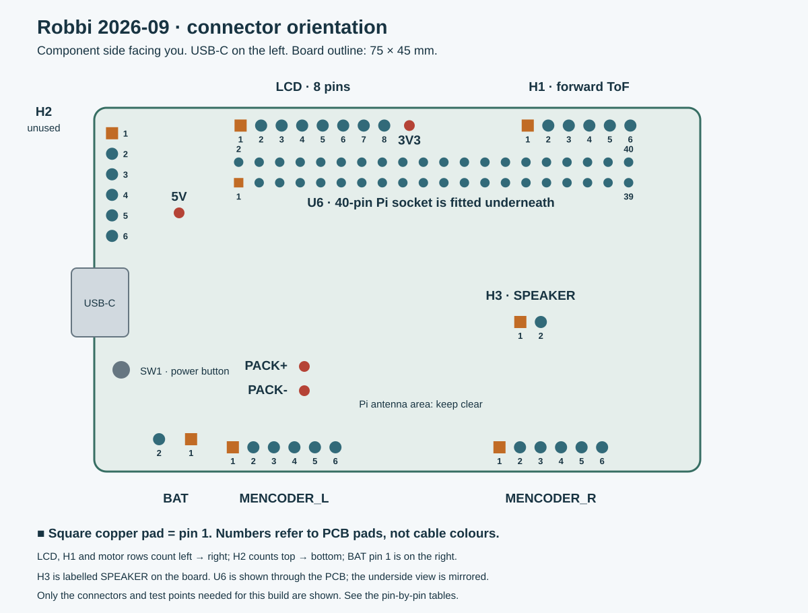
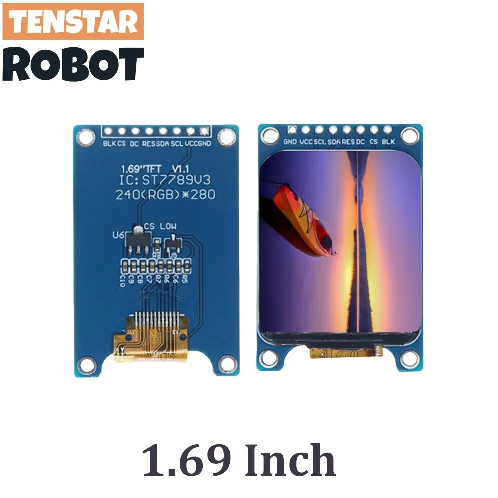

# Wiring reference · Robbi 2026-09

[Guide home](README.md) · [Bench tests](04-bench-tests.md) · [Assembly](05-assembly.md)

Use this page with the supplied `gerber_v1.zip`, `bom_v1.csv` and `pickandplace_v1.csv`. Connector positions come from that placement file; the connections below were checked through the four copper layers and plated holes in that Gerber package. They describe the PCB, not an assumed wire-colour scheme.

## Orient the board

Place the board **component side up, USB-C to the left**, with the LCD and H1 headers along the top. In this view:

- **LCD, H1 and both motor connectors:** pin 1 is at the left end.
- **H2:** pin 1 is at the top end; leave H2 empty in this build.
- **BAT:** pin 1 is the **right-hand** pad, connected to battery positive. Pin 2 is negative.
- **SPEAKER / H3:** pin 1 is on the left. `H3` is the manufacturing-file reference; `SPEAKER` is the board label.
- **U6:** the female 40-pin socket fits on the **underside**. Do not mirror this top-view drawing when identifying the copper pads.

Pin 1 has a square copper pad. Verify the pad when a fitted connector hides the outline. All wiring and continuity checks below are done with the battery and USB disconnected.

## Display · LCD

| PCB pin | Signal | Connect to |
|---|---|---|
| 1 | 3V3 | VCC |
| 2 | GND | GND |
| 3 | SPI clock | SCL |
| 4 | SPI MOSI | SDA |
| 5 | Reset | RES |
| 6 | Data/command | DC |
| 7 | Chip select | CS |
| 8 | 3V3 backlight | BLK |

**The display's first two pins are GND, VCC; the PCB's first two pins are VCC, GND.** Match the printed signal names. Do not connect the two eight-pin rows with an unverified straight-through harness. On this display, `SDA` and `SCL` are SPI data and clock, not the ToF sensor's I²C bus.

## Forward distance sensor · H1

| PCB pin | Signal | Connect to |
|---|---|---|
| 1 | 3V3 | VCC |
| 2 | GND | GND |
| 3 | I2C SDA | SDA |
| 4 | I2C SCL | SCL |
| 5 | Unrouted | Leave unconnected |
| 6 | XSHUT / BCM13 | XSHUT |

Connect five signals: VCC, GND, SDA, SCL and XSHUT. **H1 pin 5 has no routed connection**; the ToF module's interrupt output is unused. Map by the sensor's printed labels, not by its physical left-to-right order. H1 pin 6 reaches Pi physical pin 33 / BCM13. The spare H2 connector uses physical pin 32 / BCM12 for XSHUT and stays empty.

## Motors and encoders

Left/right always means **Robbi's viewpoint looking forward**. Each six-wire cable carries both motor power and encoder feedback. Encoder VCC is 3.3 V; the motor pair is a separate circuit.

### Left · MENCODER_L

| PCB pin | Signal | Connect to |
|---|---|---|
| 1 | Motor terminal 1 | Motor lead 1 |
| 2 | 3V3 encoder supply | Encoder VCC |
| 3 | Encoder A / BCM27 | Encoder A |
| 4 | Encoder B / BCM5 | Encoder B |
| 5 | GND | Encoder GND |
| 6 | Motor terminal 2 | Motor lead 2 |

### Right · MENCODER_R

| PCB pin | Signal | Connect to |
|---|---|---|
| 1 | Motor terminal 1 | Motor lead 1 |
| 2 | 3V3 encoder supply | Encoder VCC |
| 3 | Encoder A / BCM6 | Encoder A |
| 4 | Encoder B / BCM16 | Encoder B |
| 5 | GND | Encoder GND |
| 6 | Motor terminal 2 | Motor lead 2 |

Use the supplied motor cable at the encoder board and terminate its other end to match this table. The exact motor-cable colour assignment has not been established from the available references. Identify the motor maker's pin labels before powering it; do not guess encoder power from the wire colours.

For this PCB, set `hardware.right_encoder_b_pin: 16`. GPIO7 was a repair on the original robot's faulty Pi; it is not the normal route on a new board. Do not join GPIO7 and GPIO16.

## Speaker · SPEAKER / H3

| PCB pin | Signal | Connect to |
|---|---|---|
| 1 | Speaker + | Speaker + |
| 2 | Speaker - | Speaker - |

Use the specified **20 mm, 8 Ω, 0.5 W** speaker. Both leads go to the amplifier outputs; neither goes to ground.

## Battery · BAT

| PCB pin | Signal | Connect to |
|---|---|---|
| 1 | Battery + / PACK+ | Holder positive |
| 2 | Battery - / PACK- | Holder negative |

Use the **VH3.96, two-pin cable with female socket contacts**. With the cell removed, trace the holder's positive contact to BAT pin 1 and its negative contact to pin 2. Confirm the cable polarity even if it arrives prewired.

The motor driver's supply is connected to `PACK+`, the battery rail, rather than to the regulated Pi 5 V rail. The selected motors are rated 3 V. Keep initial movement bounded and use a verified duty limit; the loaded motor/thermal limits remain a physical measurement to document.

## Pi, camera and microphone

- The Pi joins the underside U6 socket directly through its complete **2 × 20 header**. There are no jumper wires between the Pi and custom PCB.
- Use the **16 cm, 22-pin-to-15-pin camera ribbon**. The narrow 22-pin end fits the Pi Zero; the wide end fits the camera. Seat contacts against the socket contacts, close both latches and leave a gentle bend.
- Plug the **left-angle Micro-USB OTG adapter** into the Pi's **USB data** port and plug the mini USB microphone into it. `PWR IN` cannot carry microphone data.

## Power test points

Keep the black multimeter probe on **PACK−**. Use the marked single test pins instead of trying to touch adjacent IC legs.

| Red probe | When to check | Expected function |
|---|---|---|
| PACK+ | Battery connected | Battery voltage; also feeds motor-driver VM |
| 5V | Battery connected and power button pressed | Nominal 5 V output for the Pi |
| 3V3 | **After the Pi is attached and powered** | Nominal 3.3 V from the Pi |

**A bare PCB does not generate its own 3.3 V rail.** Do not treat a missing 3.3 V reading during the battery-only test as a fault. Nominal rail names are not measured acceptance tolerances; record the actual unloaded and loaded readings.

Two placement-file test-point names are misleading: `TP_USB_DETECT` actually connects to right motor output 2 (the board labels it `MR2`), and `TP_I1C_SCL` connects to Pi physical pin 27 rather than the main I²C clock. Use the named power pins above and the connector tables instead.

[Download the connector table as CSV](hardware/pcb/connector-pinout.csv).
