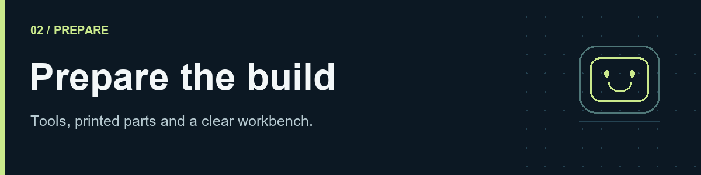
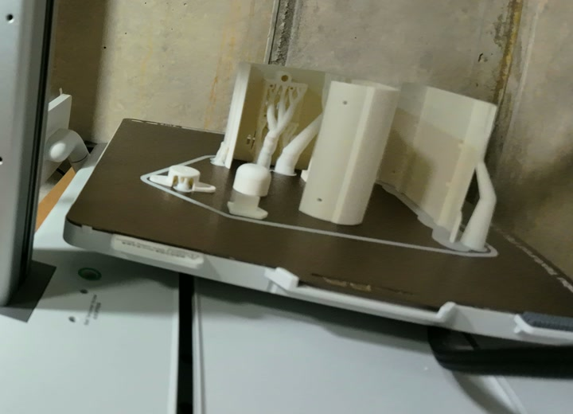

# 2. Prepare tools and printed parts

[Guide home](README.md) · [← Parts](01-parts.md) · [Software →](03-software.md)

## Tools

| Tool | Used for |
|---|---|
| 3D printer, makerspace or print service | Body, head, wheels and internal mounts |
| Temperature-controlled soldering iron, stand, solder and electronics flux | Wire joints, any omitted through-hole headers and heat-set inserts with an appropriate tip |
| Small manual driver; H1.5, H2 and H2.5 hex bits; small Phillips bits | Fasteners; check the actual head before using a bit |
| Flush cutters, wire stripper, tweezers and small pliers | Harness preparation and handling small parts |
| Heat-shrink tubing and suitable heat source | Insulating individual wire joints |
| Hot-glue gun and matching sticks | Securing the forward ToF sensor and limited wire strain relief |
| Multimeter with continuity and DC voltage ranges | Finding shorts, checking polarity and measuring rails |
| Knife/deburring tool, small file and calipers | Removing supports and checking fits |
| microSD reader and computer | Flashing the operating system and copying the release |
| Tape measure, tape and a flat test area | Wheel and motion calibration |
| Optional current-limited bench supply | Controlled first power-up with the release's specified input and limit |

Use an uncluttered, nonconductive work surface and a small tray for screws. Ventilate soldering work. Do not solder directly onto the 18650 cell; prepare the holder leads with the cell removed.

## Print the matching release

Download [robo_4_astra.zip](hardware/prints/robo_4_astra.zip) and extract **robo_4_astra.stl** on your computer. The archive contains the original assembly STL without changes to its geometry. It contains an assembly, modelled purchased hardware and separate wheel shapes, rather than a prepared print plate. See [the model notes](hardware/prints/README.md) before slicing. Export/identify the actual printable bodies and confirm the scale against a known dimension. Print the confirmed millimetre-scale parts at **100%**. Scaling the shell to compensate for a tight fit also changes the bearings, board mounts and screw locations.

The [model inventory](hardware/prints/README.md#parts-identifiable-in-the-supplied-stl) identifies the shell, panels, head pieces and wheel geometry already present in this file.

Use this checklist while separating printable geometry from the purchased electronics in the assembly STL. The shell, two side panels, head front/rear, wheel centre and tread ring are identifiable; print materials and the successful slicer settings are not stored in STL:

| Group | Inspect before assembly |
|---|---|
| Main body and closing panel(s) | Both axle openings, motor seats, board mounts, battery access and front apertures |
| Head/face bezel and rear/joint parts | Screen aperture, display mounting features and cable passage |
| Two wheels and their tread/tyre parts | Shaft fit, concentricity, tread fit and body clearance |
| Pi/PCB carrier | Hole locations, underside insulation and port access |
| Camera, speaker and ToF mounts | Exact module outline, lens/window clearance and connector access |
| Bearing and joint retainers, if separate | Bearing seating depth and unobstructed motion |

Do not use the motion-studio `robbi-body.stl` and `robbi-head.stl` files as a complete print kit: the available preview models do not establish all separate printable parts or their counts.

*Illustrative print layout. Use the released parts and their specified print orientations for your build.*

The supplied STL does not contain slicer settings. Add the release's slicer project for orientation, supports, layer height, walls, infill and material. Use the settings for the released parts rather than guessing an orientation or material. Print a small insert/bearing fit sample first if changing printer, material or slicer settings.

## Clean and dry-fit

1. Remove supports and loose strings, particularly inside wire passages and screw holes.
2. Deburr mating surfaces without enlarging bearing seats or motor pockets.
3. Lay each component in its mount with **no battery installed**. Check that plugs can still be inserted and removed.
4. Place the PCB carrier inside the body and close the panels loosely. Check clearance above the board's tall components and header pins.
5. Sort screws by diameter and length. A screw should engage its intended thread without bottoming out against a board, motor or cell.

## Inserts and bearings

Check the heat-set inserts now, but fit the **side-panel inserts** at the step shown in [Assembly](05-assembly.md#7-fit-the-side-panel-inserts). These provide the threads for fastening the side panels to the main body. M2 specifies only the thread: outside diameter and length must match the printed pockets. Test the fit and heated-tool technique on a spare printed boss first.

The specified bearing is **MR128ZZ, 8 × 12 × 3.5 mm**. It sits in the circular body recess around the motor-shaft opening; the [new close-ups](05-assembly.md#1-mount-the-motors-first) show both the seat and the matching D-shaped wheel hub. Press against the outer race when fitting a bearing into its printed bore. Align the wheel hub's flat with the shaft flat before pressing the wheel on; do not hammer through the bearing or onto the gearbox shaft. Stop if the plastic starts to split or distort.

**Checkpoint:** the shell closes without force, all modules fit, and there is a clear route for the head harness and camera ribbon. The battery is still out.
