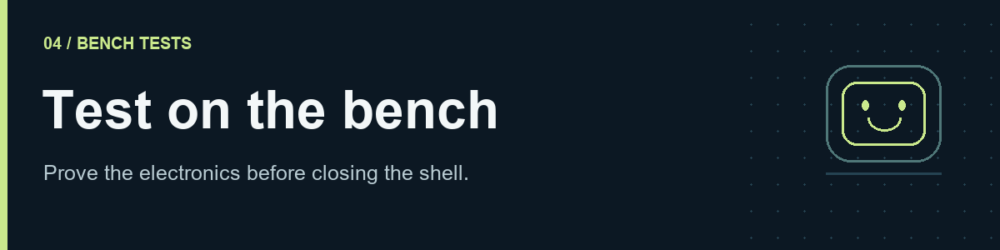
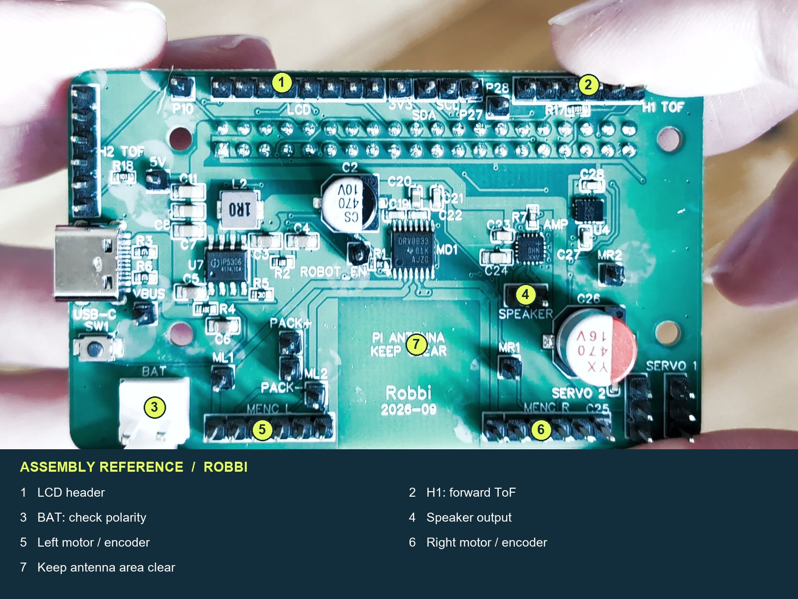
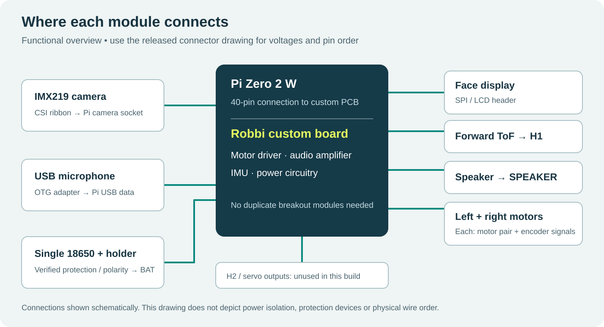
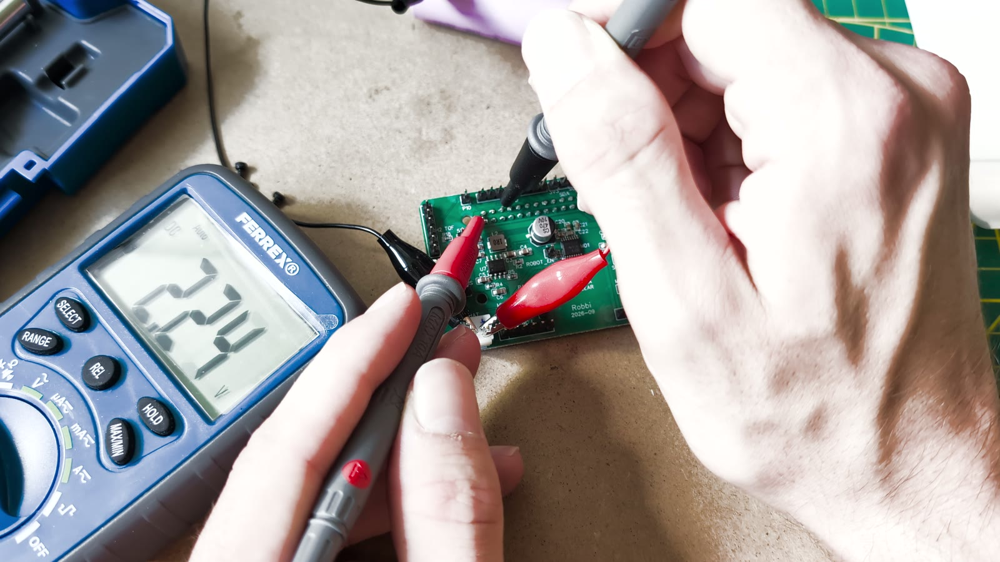
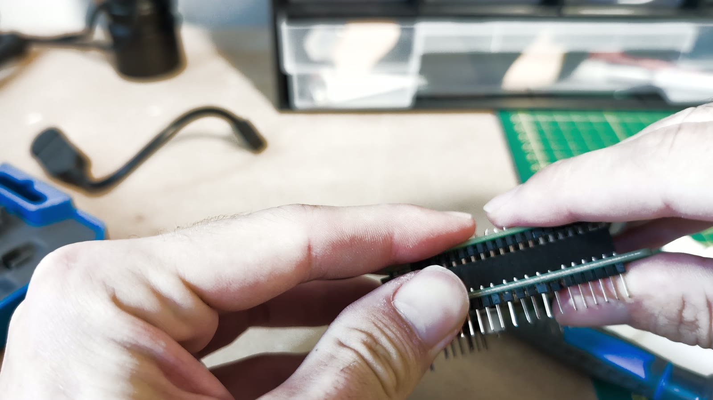
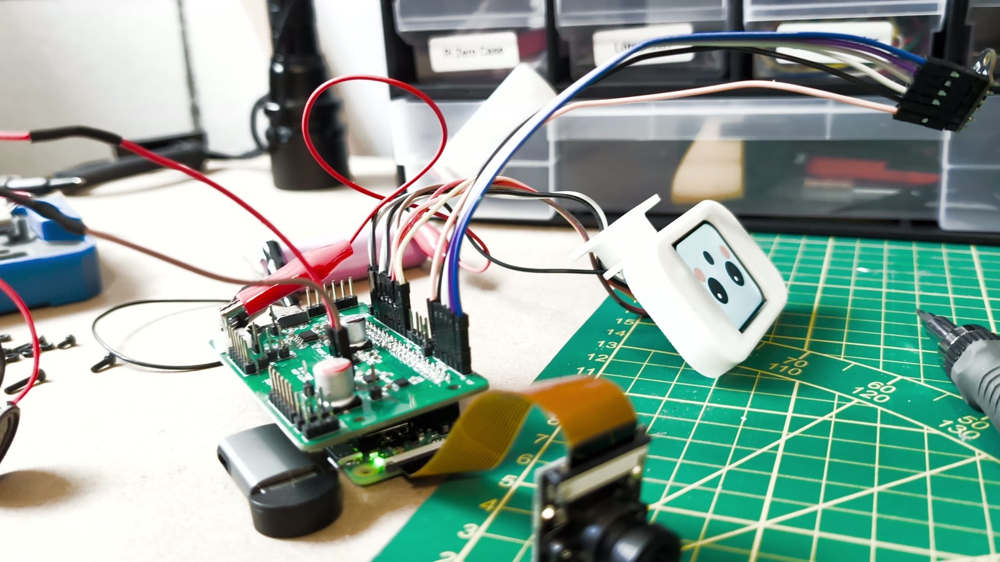
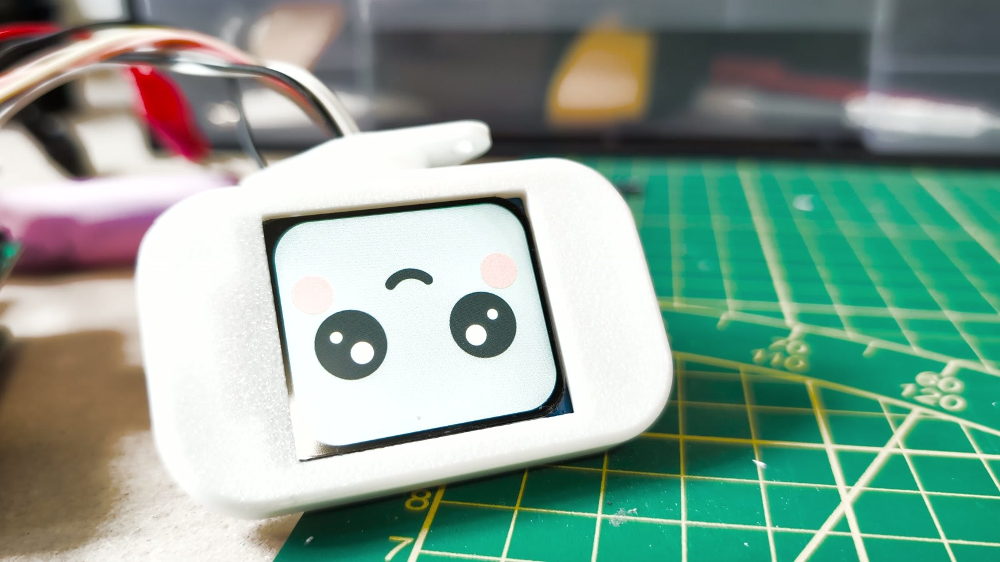

# 4. Test the electronics on the bench



[Guide home](README.md) · [← Software](03-software.md) · [Assembly →](05-assembly.md)

Test the electronics on a nonconductive work surface **before fitting them inside the body**. The order is: bare PCB → Pi/PCB connection → connected peripherals. The motors remain disconnected.

## Before connecting power

The board is labelled **Robbi 2026-09**. The [manufacturing package supplied with this guide](hardware/pcb/README.md) includes IP5306, DRV8833, MAX98357A and LSM6DS3TR-C, matching the visible parts. Older design folders describe a different BQ25895/TPS61088 power circuit and incompatible connector assignments. Do not combine those older schematics with this board.

**Use the [connector drawing and pin-by-pin wiring tables](WIRING.md).** They cover the supplied September manufacturing package, including pin 1, display power-pin reversal, encoder feedback and battery polarity. Check each finished harness against those tables before applying power.



The photograph identifies connector locations; the [top-view drawing](assets/connector-map.svg) identifies pin 1. Label each wire by signal at both ends. The display needs special care: its GND/VCC order differs from the PCB.



*Functional overview, not a wiring pinout. Power protection and the released PCB's rail design must be verified separately.*

## 1. Test the bare PCB

1. Remove the cell and disconnect all USB power. Inspect both sides of the board for solder bridges, loose strands, bent pins and offset connectors.
2. Verify battery polarity from the holder to `BAT`, the specified lead protection, and the absence of a persistent short across each supply. A brief continuity beep while capacitors charge is not a complete diagnosis.
3. Check the underside 40-pin socket orientation. **U6 belongs on the back of the board** and is marked for hand soldering in the manufacturing files.
4. Leave the Pi, motors and every peripheral disconnected. Attach **only the battery** using the correct, verified connector.
5. **Press the power button. Connecting the battery alone does not switch the PCB on.**
6. Put the black probe on **PACK−**. Measure **PACK+** (battery rail) and **5V** (nominal 5 V output). The motor driver uses the battery rail. **Do not require 3.3 V at this stage: that rail is supplied by the Pi, which is not attached yet.** Record the actual readings in [the build record](build-record.csv).
7. Switch off and disconnect the battery before joining the Pi or changing any connection.



> [!IMPORTANT]
> The [power test-point drawing](WIRING.md#power-test-points) identifies PACK−, PACK+ and 5V. Their names establish nominal functions; measured unloaded/loaded ranges still need to be recorded. The meter reading in this illustration is not a target value. The driver is battery-fed, so verify the duty/load limit for the selected 3 V motors before wheel tests.

## 2. Join the PCB directly to the Pi

1. Keep both battery and Pi USB power disconnected.
2. Align the PCB's underside female socket with **all 40 pins** on the Pi. Check both rows for a one-pin or one-row offset.
3. Hold the boards parallel and press evenly at the connector. Support the boards instead of pressing on unsupported corners.
4. Check the spacing and clearance from conductive fasteners.
5. Reconnect the battery, press the power button and let the Pi start. With the black probe on **PACK−**, check **3V3** for the nominal 3.3 V logic rail. Shut the Pi down and remove power again before adding peripherals.

**There are no jumper cables between these two boards:** the socket mates directly with the Pi's header. You will make this same connection again after the Pi is screwed onto the back panel.



## 3. Connect the peripherals on the bench

Use the [pin-by-pin tables](WIRING.md) to connect the LCD, microphone, camera, ToF sensor and speaker while power is off. The table below is a final connection checklist. Connect the camera ribbon squarely and close both latches. The USB microphone uses the Pi's **USB data** port through the OTG adapter, not `PWR IN`.

| Connection | Signals to identify before plugging in | Check |
|---|---|---|
| Pi ↔ custom board | All 40 header positions, including 5 V, 3.3 V and ground | Full alignment; no skipped row/pin |
| Display ↔ LCD header | VCC, GND, clock, data, reset, D/C, CS, backlight | Match **signal labels**, not wire colour; confirm VCC and backlight supply |
| Left motor/encoder ↔ left connector | Motor pair, encoder supply, encoder ground, A and B | Encoder power and motor power are distinct signals |
| Right motor/encoder ↔ right connector | Motor pair, encoder supply, encoder ground, A and B | Confirm the released right-B route; see repair note below |
| Forward ToF ↔ H1 | Supply, ground, SDA, SCL, XSHUT; any unused interrupt pin | Exact module voltage and pin order; H2 stays empty |
| Speaker ↔ SPEAKER | Amplifier's two speaker outputs | Neither lead should be assumed to be ground |
| Camera ↔ Pi CSI | Matching ribbon ends and contact orientation | Power off; latches fully closed |
| Microphone ↔ Pi USB | OTG data adapter and USB microphone | Use USB data port, not PWR IN |
| Cell holder ↔ BAT | Verified positive and negative | Female VH3.96 two-pin lead; polarity measured before insertion |

Reconnect the battery, **press the power button**, and let the installed service start with `config/robot.yaml`. Do not also feed the Pi through its USB power socket unless the released power circuit explicitly supports it. Leave motor output disabled and motor leads unplugged.



Use insulated, secure connections for your build. Temporary clip leads are not a finished battery harness.

## 4. Check each subsystem

Use dashboard Settings or `~/robbi-v2/config/robot.yaml` for all edits below. After manual edits, run `sudo systemctl restart robbi-v2.service`. The installer already enables the display, camera, front ToF and IMU; verify those settings rather than selecting another profile. Keep `hardware.enable_motors: false` and `runtime.calibration_confirmed: false`.

### Display

Set `hardware.enable_lcd: true`. Restart and select a face. The physical panel is 240 × 280; the runtime draws at 280 × 240 with `offset_left=20`, DC25, reset24 and SPI0/CE0. Those values are currently in `src/robot/media.py`.



Check that a complete face is visible and stable. If the backlight is on but the image is missing, recheck the signal labels and selected interface before changing geometry.

### Camera

Stop Robbi with `sudo systemctl stop robbi-v2.service`, then test camera detection and capture:

```bash
rpicam-hello --list-cameras
rpicam-still -n -t 2000 -o camera-check.jpg
```

Confirm an IMX219 is detected and inspect the actual image for focus, obstruction and orientation. If the third-party module is not auto-detected, check its manufacturer's overlay instructions rather than enabling the legacy camera stack. Bookworm uses `rpicam-*` applications; see the [official camera software guide](https://www.raspberrypi.com/documentation/computers/camera_software.html).

Then confirm `camera.enabled: true`, run `sudo systemctl start robbi-v2.service` and check that the dashboard image updates when you move an object. Stop the runtime before using `rpicam-*` again, because both would need the camera.

### Microphone and speaker

First list ALSA devices:

```bash
arecord -l
aplay -l
```

Choose the actual card names shown on your Pi; do not rely on card numbers remaining constant. With the runtime stopped, record a short sample (substitute the USB mic's card name for `Device` if necessary):

```bash
arecord -D plughw:CARD=Device,DEV=0 -f S16_LE -r 16000 -c 1 -d 5 mic-check.wav
```

Play the file on your computer to check capture before testing the tiny speaker. Configure `audio.mic_device` and `audio.alsa_device` in `config/robot.yaml` to match the device list. For speaker testing, start with a quiet speech sample and low software volume; the specified speaker is only 0.5 W. Confirm the amplifier/card name rather than assuming it is always `MAX98357A`.

### Distance and orientation readings

Set `tof.enabled: true` and `imu.enabled: true`, leaving `tof.h2_enabled: false`. Restart and watch live values in diagnostics.

- Move a flat object toward and away from the forward ToF. Values should change plausibly and have fresh timestamps. H1 boots at `0x29` and is assigned `0x30` by the runtime each startup; the configuration's decimal `48` means `0x30`.
- Gently rotate the robot while holding the body. Orientation should respond in the same sense and settle when held still. The recorded LSM6DS3TR-C device was at `0x6B`; identification is more useful than assuming every board uses that address.

Check that both sensors respond here. Perform the full [IMU calibration](06-calibration.md#1-calibrate-the-imu) after physical assembly.

## 5. Shut down before assembly

Record a pass for display, camera, microphone, speaker, forward distance and live orientation. Resolve failures while the components are easy to reach. Shut Linux down, switch off and remove the battery before mounting the electronics.

**Checkpoint:** each peripheral works on the bench; the bare-board supplies have been checked; motor output is still disabled. Continue to [Assembly](05-assembly.md).

## GPIO reference

<details>
<summary>BCM assignments and the prototype encoder repair</summary>

These are **BCM numbers**. The physical header position is shown separately to avoid mixing the numbering systems. They come from the current runtime and its hardware acceptance notes, not a confirmed new PCB release.

| Function | BCM | Physical header pin |
|---|---:|---:|
| I²C SDA / SCL | 2 / 3 | 3 / 5 |
| Motor driver enable | 26 | 37 |
| Left motor inputs | 4 / 17 | 7 / 11 |
| Right motor inputs | 22 / 23 | 15 / 16 |
| Left encoder A / B | 27 / 5 | 13 / 29 |
| Right encoder A | 6 | 31 |
| Right encoder B, intended route | 16 | 36 |
| Right encoder B, original robot's repair only | 7 | 26 |
| Display SPI clock / data / CE0 | 11 / 10 / 8 | 23 / 19 / 24 |
| Display D/C / reset | 25 / 24 | 22 / 18 |
| Speaker I²S clock / LR clock / data out | 18 / 19 / 21 | 12 / 35 / 40 |
| Forward H1 ToF XSHUT | 13 | 33 |
| Optional H2 XSHUT, unused here | 12 | 32 |

**Encoder selection:** the installer writes `hardware.right_encoder_b_pin: 16` for the standard board. Match this to the released PCB route before motor tests. Alternate wiring may select `7`, which reserves Servo 1; never bridge GPIO7 and GPIO16. Do not rely on a missing-field default: private prototype and public runtime defaults differ. Set the field explicitly to match the physical connection. Use dashboard diagnostics for the selected pin rather than an old standalone probe with hard-coded assignments.

</details>

## Battery and shutdown

Use the external charger selected in the parts guide for initial charging. Remove the cell from the robot after shutting Linux down and switching power off. Onboard USB charging should only be included in the public instructions after the actual circuit, cell, charge current and thermal/protection checks are confirmed.

The reference P30B is a 3.6 V nominal Li-ion cell with a 4.2 V charge voltage; its current and temperature limits are conditions to respect, not the robot's required operating current. See the [manufacturer's cell datasheet](https://www.molicel.com/wp-content/uploads/Product-Data-Sheet-of-INR-18650-P30B-80111-1.pdf). Do not solder to the cell, use a damaged wrapper, or leave its terminals loose among tools.

For normal shutdown, run `sudo shutdown -h now`, wait for shutdown to finish, then switch the robot off. A physical power cut is available for an immediate fault; it is not the routine Linux shutdown procedure.
