# 5. Assemble Robbi

[Guide home](README.md) · [← Bench tests](04-bench-tests.md) · [Calibration →](06-calibration.md)

Watch the [assembly video](https://youtu.be/MBummcW5DIk?t=136) alongside these steps.

Start here once the [bench tests](04-bench-tests.md) pass. Keep the battery out while fitting parts, changing plugs and soldering. Keep the [wiring reference](WIRING.md) open alongside this page. The parts list establishes M2 socket-head screws, M3 × 14 mm screws, M2 inserts and MR128ZZ bearings; the remaining per-location fastener lengths/counts are tracked in the [release checklist](RELEASE-CHECKLIST.md).

**Build order:** motors → Pi on back panel → wired PCB → head → back-panel fit → ToF → side-panel inserts → final soldering.

## 1. Mount the motors first

**You need:** main body, two matching encoder motors, their leads, wheels and the release-specified retainers/bearings.

1. Define left and right from **Robbi's viewpoint looking forward**. Label the leads `L` and `R`.
2. Attach the matching motor/encoder plugs while the sockets are accessible. Feed the leads into the body.
3. Seat each gearbox in its printed motor mount, with the output shaft aligned to the wheel opening. The existing assembly view below shows the bearing seated in the body next to the gearbox; keep the encoder board toward the accessible interior.
4. Fit the specified retainers without forcing a misaligned motor into place. Keep the rear encoder board and rotating magnet clear of wires.
5. Seat the **MR128ZZ bearing** in the circular recess at each motor-shaft opening. The shaft projects through the centre; keep the bearing square in its seat.
6. Look for the flat on the **D-shaped motor shaft** and the matching flat inside the printed wheel hub. Align the two flats, then press the wheel on straight. Do not hammer the wheel onto the gearbox shaft or force a misaligned hub.
7. Check that the hub sits correctly at the bearing and the wheel turns without rubbing the body. Leave motor leads unplugged from the PCB until the commissioning checks call for them.

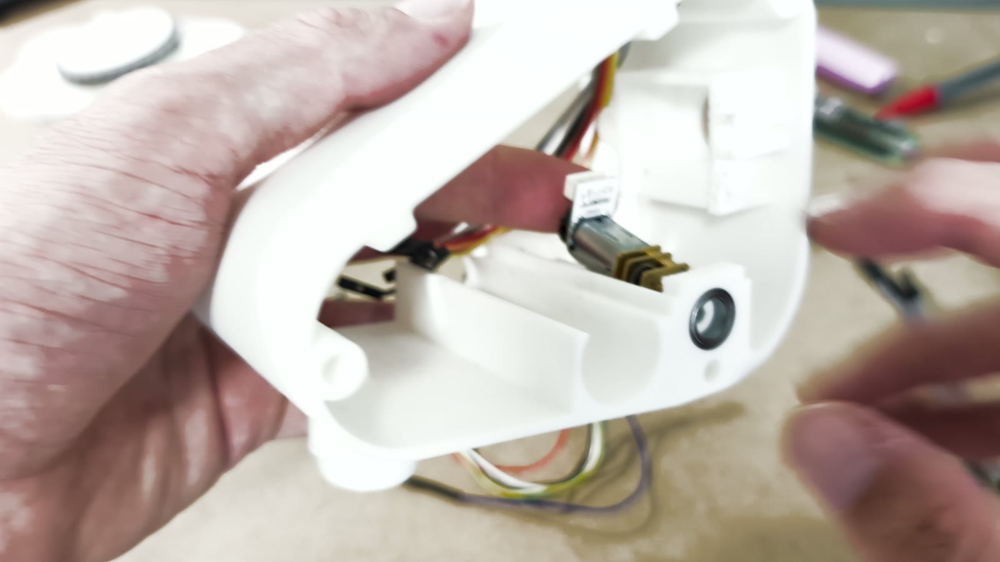

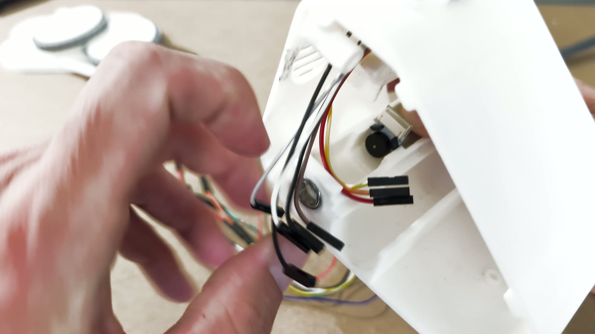

| Bearing seat and motor shaft | Matching wheel hub |
|---|---|
| 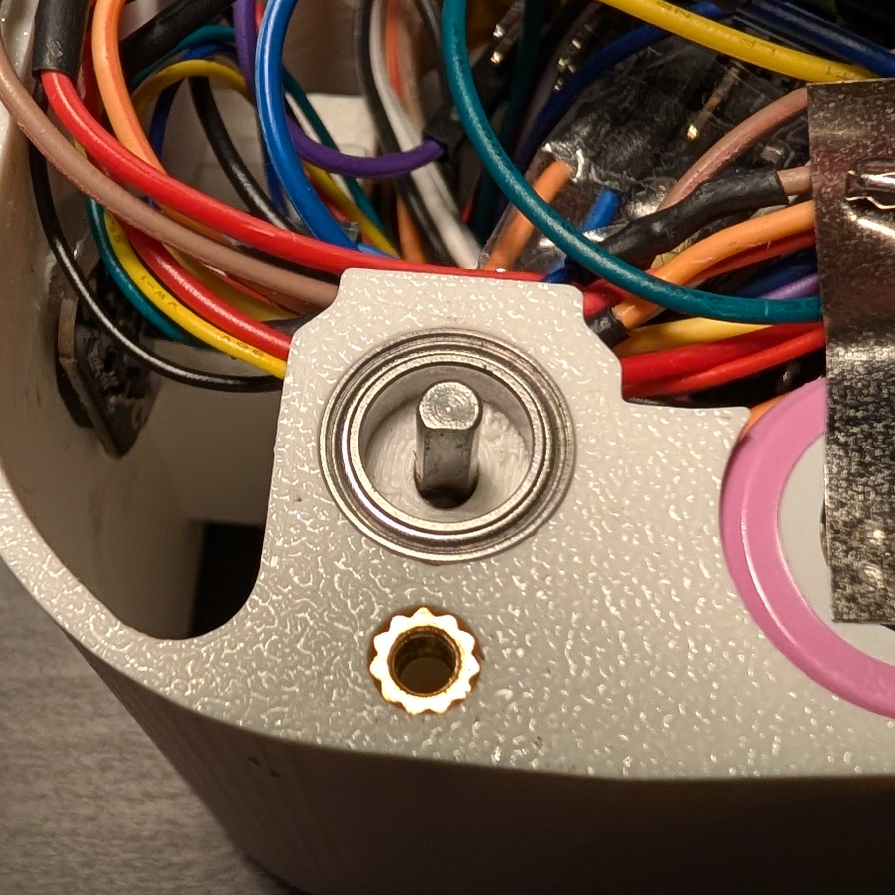 | 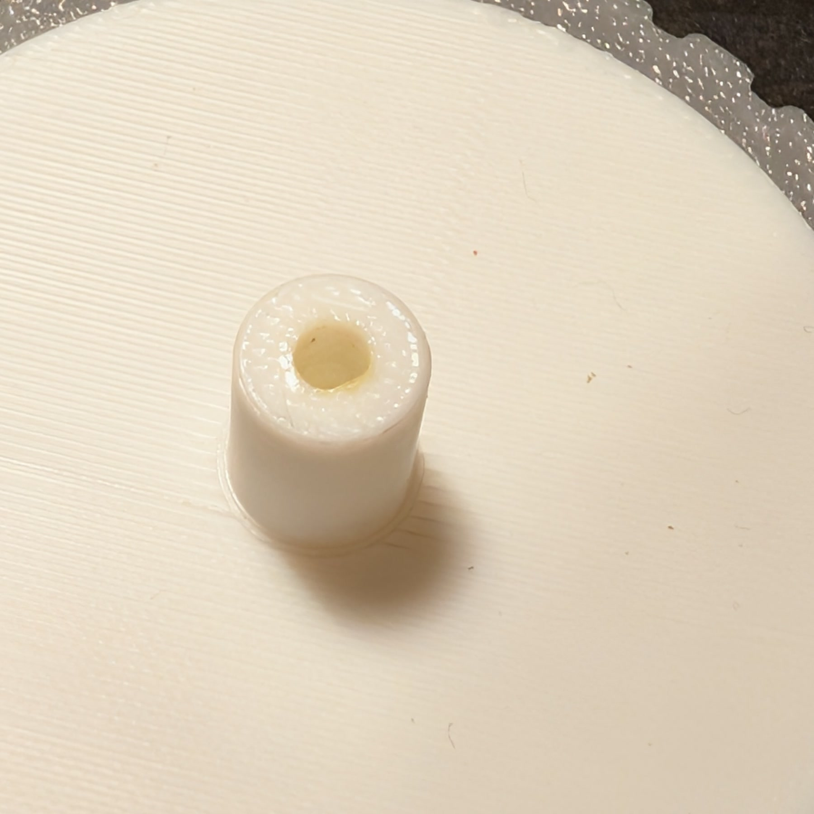 |
| The bearing belongs in the body's circular recess. Identify the flat on the shaft before fitting the wheel. | The hub has one subtly straight edge; match it to the shaft flat. |

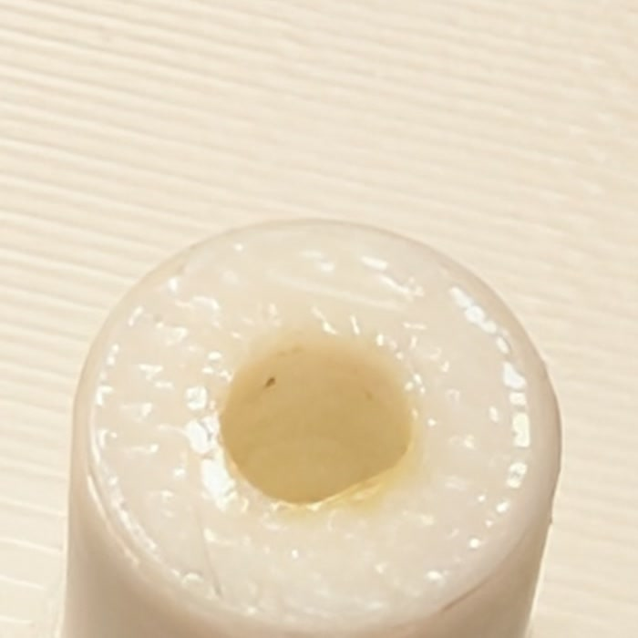

*Hub detail: the lower-right edge of the opening is flat; the remaining profile is rounded.*

**Checkpoint:** both motors and wheels are fitted before the Pi/back-panel assembly begins. Both wheels clear the body, and no wire can reach a rotating shaft or encoder magnet.

## 2. Screw the Pi onto the back panel

Keep the back panel separate from the body while working on it. Position the Pi on its mounting points and check access to the microSD card, ports and camera connector. Tighten the specified screws gently; the board must stay flat and clear of metal screw ends.

> [!TIP]
> **The updated design is easier to assemble:** the screws enter from behind, through the **outside of the back panel**. The earlier mounting arrangement shown below has different screw access.

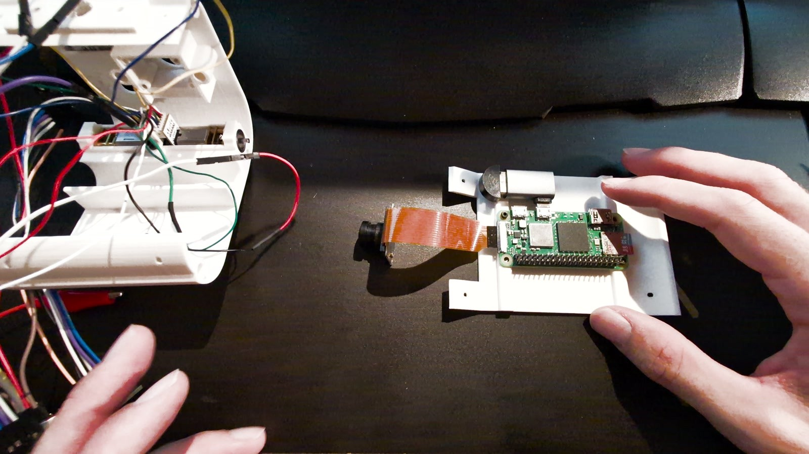

Fit the **left-angle Micro-USB OTG adapter** to the Pi's **USB data** port, then plug the USB microphone into the adapter's USB-A socket. Check that the assembly fits inside the body and does not strain the Pi connector. The Pi's separate `PWR IN` socket cannot carry microphone data.

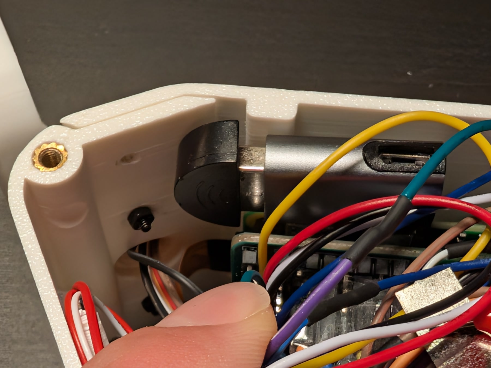

Connect the camera ribbon with power off, keep its latches closed, and leave broad bends rather than a crease. The detailed camera mounting and cable route are shown in step 5 below.

## 3. Plug the wired PCB onto the Pi

Keep the peripheral wiring connected to the PCB where practical. Bring the board to the mounted Pi, align all 40 header positions, support both boards and press the socket on evenly. This is the same direct connection used for the bench test.

Check the connector from both sides. Keep the attached wire bundle and camera ribbon free; do not pull the boards together using their cables.

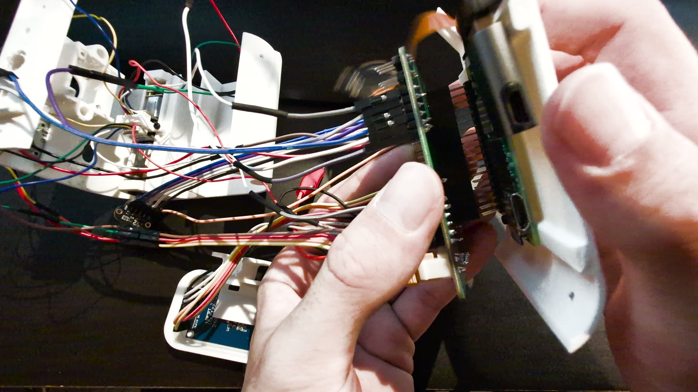

**Checkpoint:** the Pi is secured to the back panel, the PCB is fully seated, and the back panel is still outside the body.

## 4. Assemble and attach the head

**You need:** head shell/bezel, display, display harness, head bracket/joint and specified fasteners.

1. Seat the display in the bezel, centred on its supports. Fit the printed retaining bracket over the back of the display and secure it using the central screw shown in the photograph below. Avoid pressure on the glass, flex cable and small components.
2. Connect the eight display wires using the [LCD table](WIRING.md#display--lcd): PCB pins 1–8 are **VCC, GND, SCL, SDA, RES, DC, CS, BLK**. The display reverses the first two power pins relative to the PCB. Route the harness through its passage before fastening the head and bracket.
3. Attach the head base to the body. The base fixing screws pass through the mounting surface and are secured by **two nuts inside the body**. Route the harness through the opening before tightening, and keep it clear of the screw heads and nuts.
4. Leave a relaxed loop for the allowed head adjustment. Move the head gently by hand and check that nothing pulls tight.

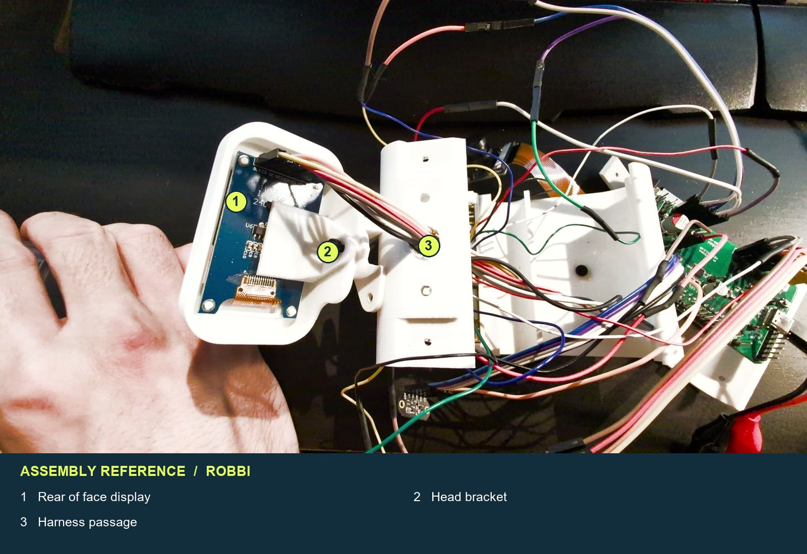

*1 — display rear; 2 — head bracket; 3 — harness passage.*

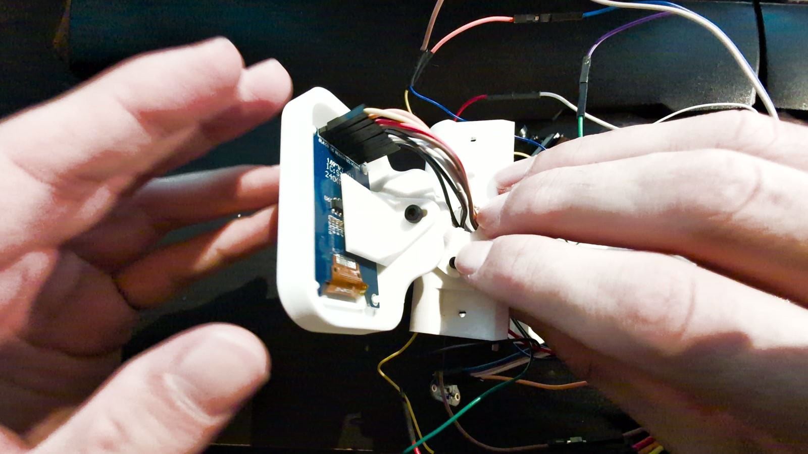

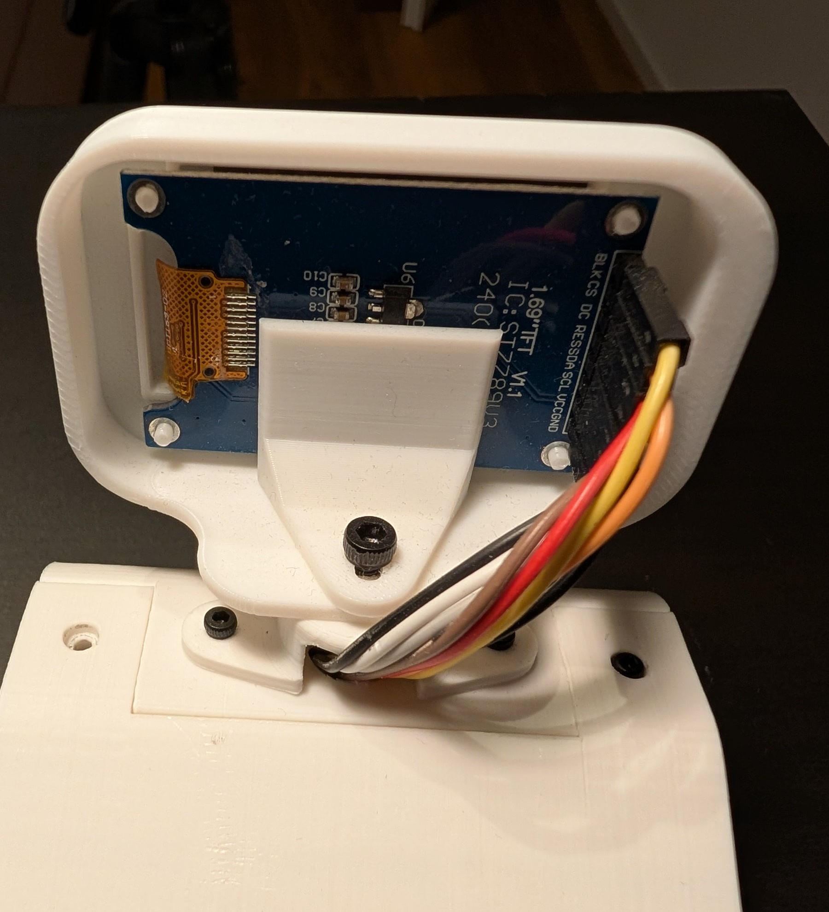

*Rear view: the central screw secures the printed display-retaining bracket. The harness exits through the opening at the head base. Leave enough slack for head adjustment.*

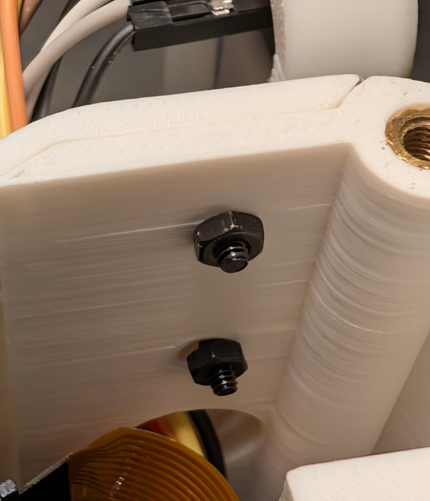

*Inside view: support the outside screw heads while gently tightening these two nuts. Keep the display harness and orange camera ribbon out of the fasteners.*

Do this **after mounting the Pi on the back panel and before sliding that panel into the body**.

## 5. Pack the wires and fit the back panel

Before packing the wires, check these three placements while access is still open:

- **Camera:** fastened to its printed supports with the mounting screws shown below, lens aligned with the body aperture, and 16 cm adapter ribbon latched at both ends.
- **Speaker:** 20 mm driver behind its grille, with its two leads running to SPEAKER/H3.
- **Battery holder:** empty holder in its body position, positive lead traced to BAT pin 1 and negative to pin 2.

Keep the speaker diaphragm and camera lens clear of glue and mounting pressure. Route the battery lead clear of the wheel area.

### Camera mounting and ribbon route

Fasten the camera module to the printed mount using the mounting screws shown. Tighten gently and keep the board flat. Check from outside that the lens is centred on its opening.

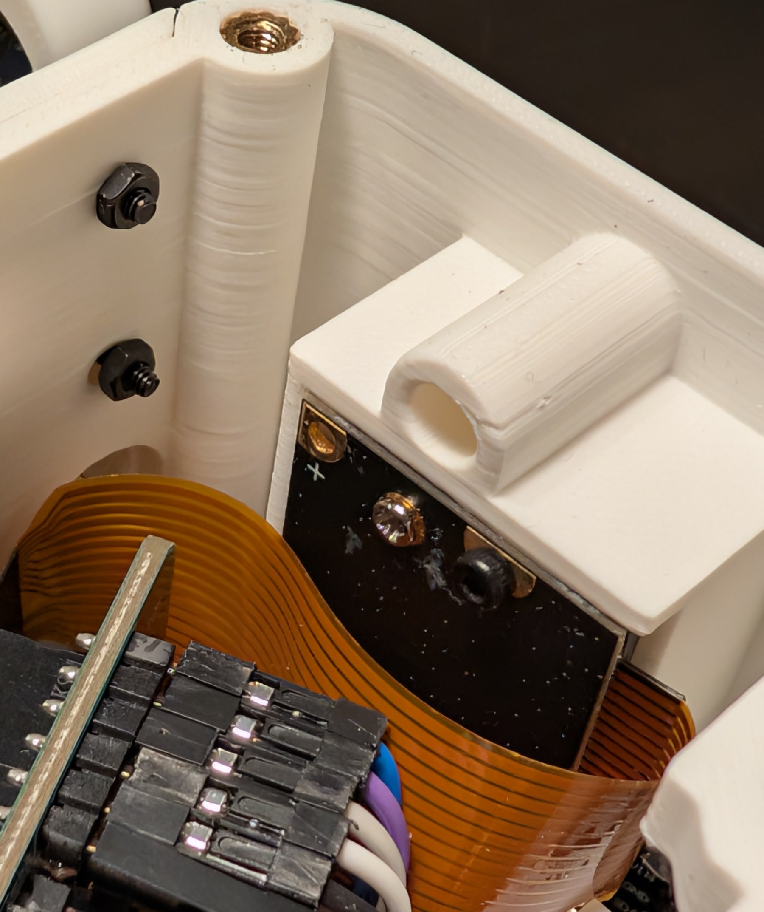

Route the orange camera ribbon in a **relaxed, inverted S-shaped path** through the available space. Leave slack at both connectors and keep it away from the head-mount nuts, the wheel area and the back-panel edge. Use broad bends; the tight folds visible on the prototype are not a reason to crease the ribbon on a new build.

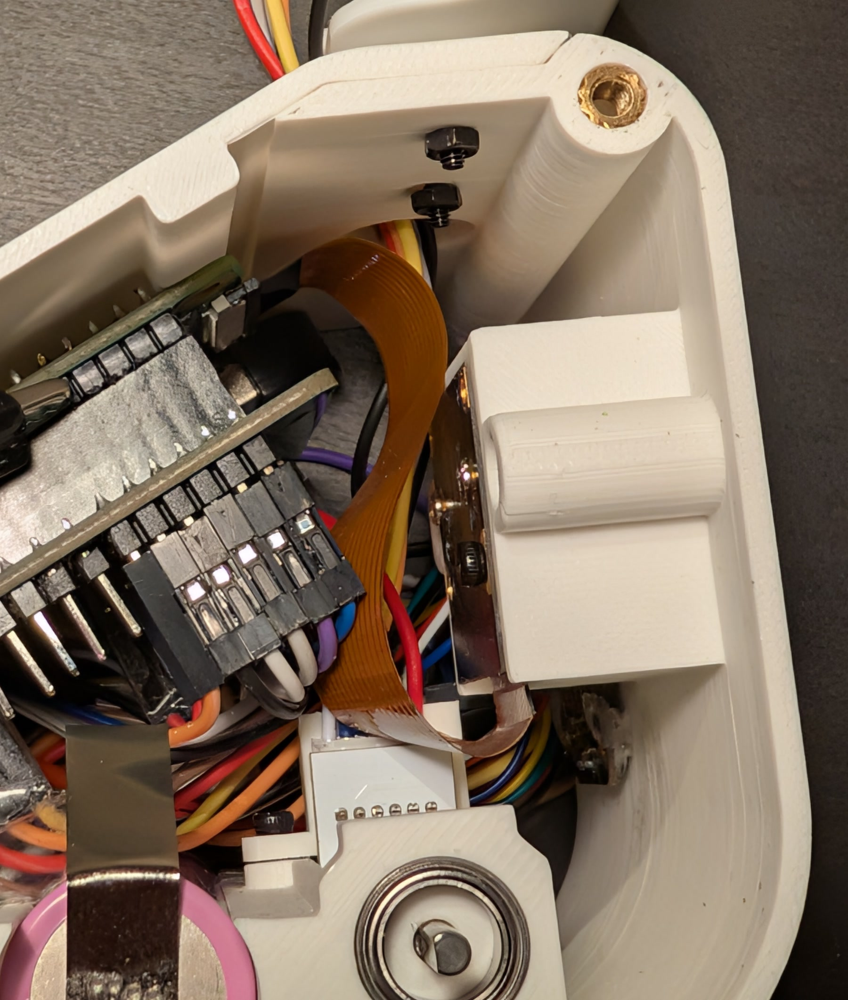

### Slide in the back panel

1. Guide the wire bundle into the main body gradually. Keep plugs seated and move loose loops away from panel edges and wheels.
2. Watch the camera ribbon continuously: **there is very little room around it**. Do not pinch, sharply crease or pull it at either connector.
3. Gently flex the main body to widen the rear opening by a few centimetres so the back panel can slide in more easily. Stop if the plastic resists or a cable becomes taut.
4. Guide the panel into its seat while tucking wires inside. If it catches, ease it back and reposition the obstruction; do not pull it closed with screws.
5. Check the camera ribbon again before fastening the panel.

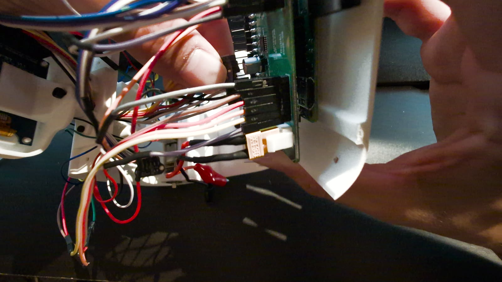

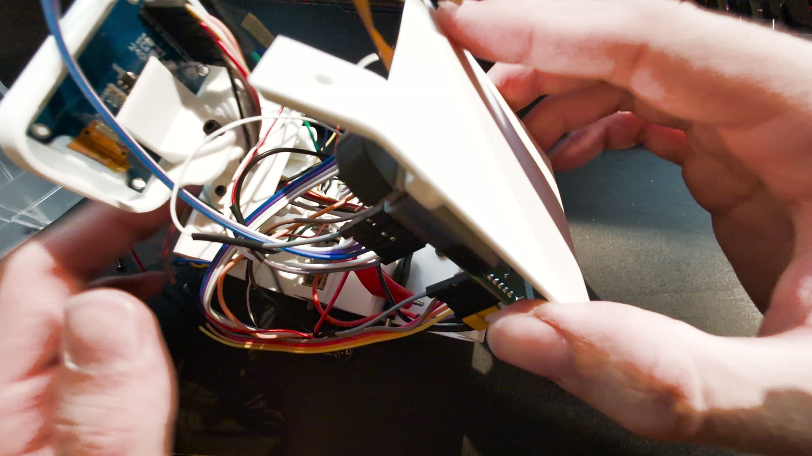

**Checkpoint:** the panel fits without trapping the camera ribbon, and the remaining sensor/wiring work is still accessible.

## 6. Hot-glue the forward ToF sensor

1. Position the ToF sensor at the forward-facing opening. Remove any shipping film and keep both optical windows exposed.
2. Apply small amounts of hot glue at the retaining surfaces, away from the optics and connector contacts.
3. Hold the sensor aligned while the glue sets. Do not let its wires pull it out of position.
4. Inspect from inside and outside: the sensor faces out through the opening and the optical path is clear.

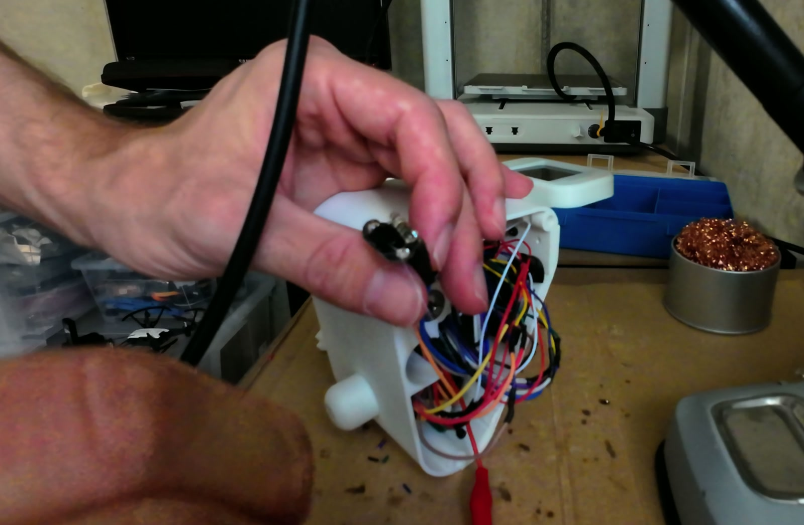

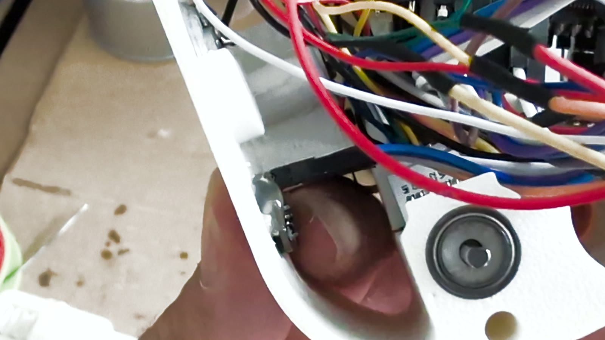

## 7. Fit the side-panel inserts

These heat-set inserts provide the threads for the screws that attach the **side panels to the main body**.

1. Match each insert's outside diameter and length to its printed pocket. Keep the battery removed and nearby wires clear of the hot tool.
2. Use the soldering iron with an appropriate tip to heat and guide the insert straight into its pocket.
3. Keep the insert square and let the heat do the work. Avoid sideways pressure and pushing it past the intended depth.
4. Allow the plastic and insert to cool before trying the side-panel screw. Fit the side panels after the remaining wiring is checked.

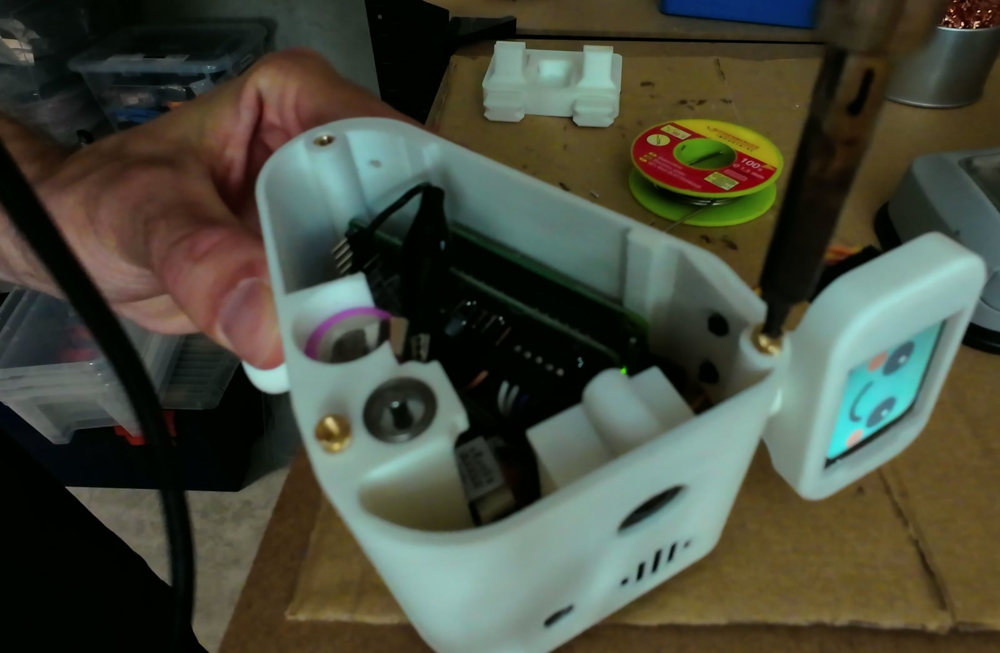

## 8. Finish the wiring and close up

The robot is now largely assembled. Finish the remaining wire joints with the battery removed.

1. Check each lead against the [wiring tables](WIRING.md). For the motor cables, identify the motor pair and the four encoder signals separately. For the battery lead, verify BAT pin 1 is positive; for the speaker, use both H3 outputs. Only splice leads that need termination or length adjustment—do not add solder joints to a complete working harness. Leave service slack without loops near the wheels.
2. Slide heat-shrink on before soldering. Strip and tin the ends, heat the joint, let the solder flow and hold it still while it cools.
3. Inspect for loose strands and bridges. Insulate each joint individually and check the lead with a gentle tug at its insulation.
4. Tuck the finished wires into the body. Recheck the camera ribbon, head loop, panel seams and encoder clearance.
5. Fit the side panels using the correct screws. Stop if a panel needs screw force to close.

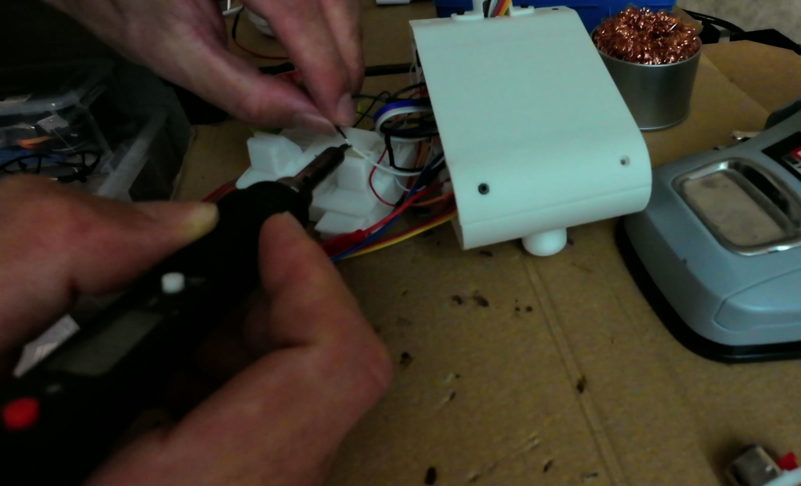

### Rear support foot

Keep the rounded **rear support foot** fitted to the underside of the body. Together with the two driven wheels, it provides the third floor contact and keeps the rear shell clear of the floor. This is a support foot/skid, not a third powered wheel.

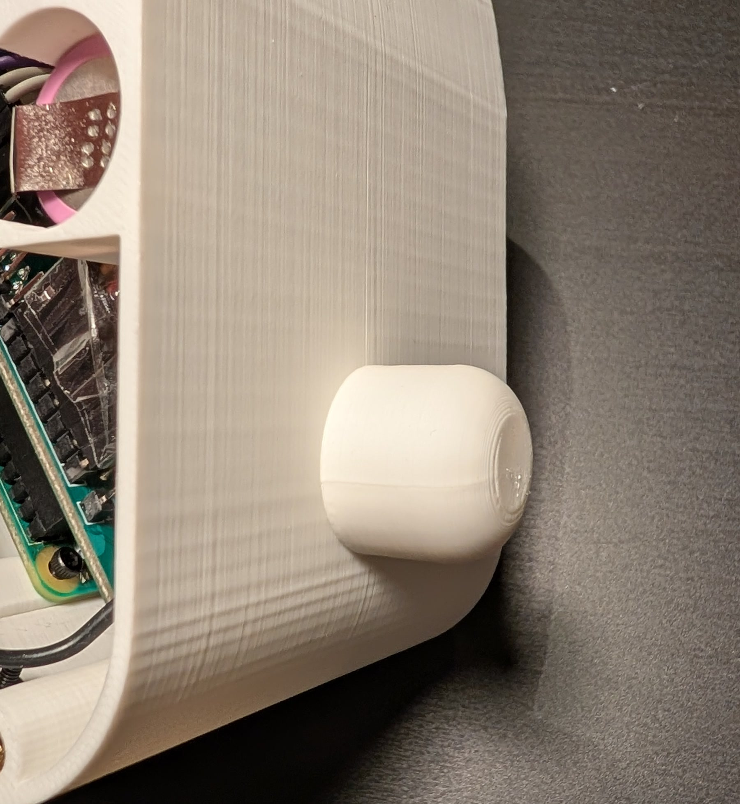

Set Robbi on a flat surface and check that the wheels and rear foot support him, the shell clears the floor and no cable hangs underneath. Check this before powered floor tests.

**Checkpoint:** continuity matches the wiring table, adjacent joints are individually insulated, the body closes freely, the rear support foot is fitted and the sensor windows remain clear. Recheck the camera image after closing: a cable that worked on the bench can be disturbed when fitting the panel. Continue with [IMU calibration and final checks](06-calibration.md).
