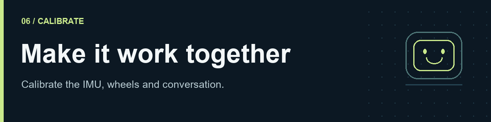
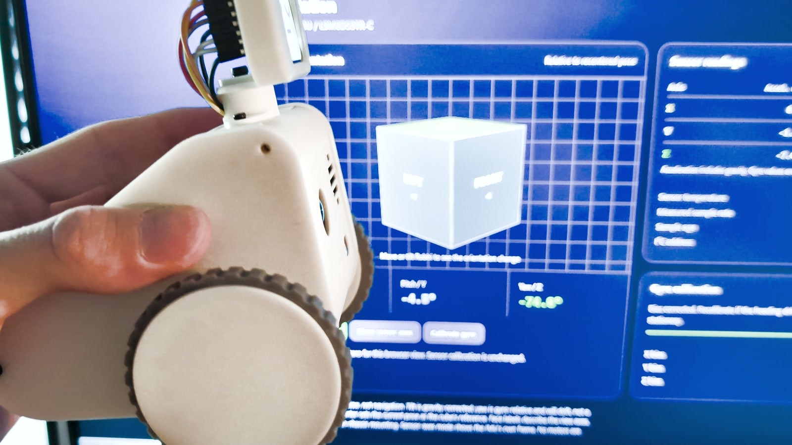
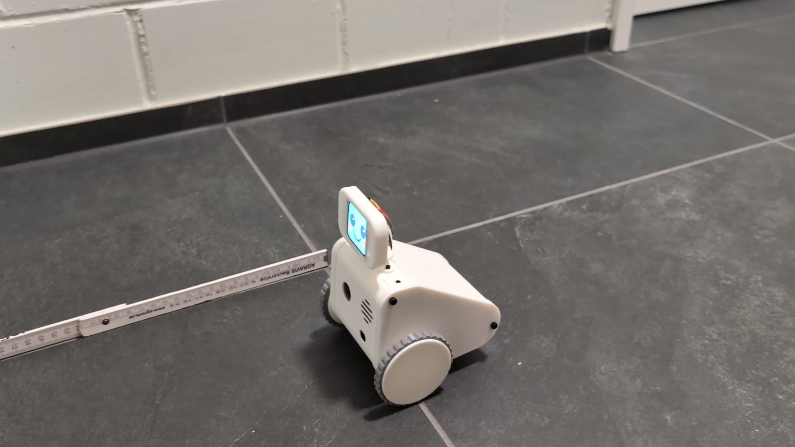
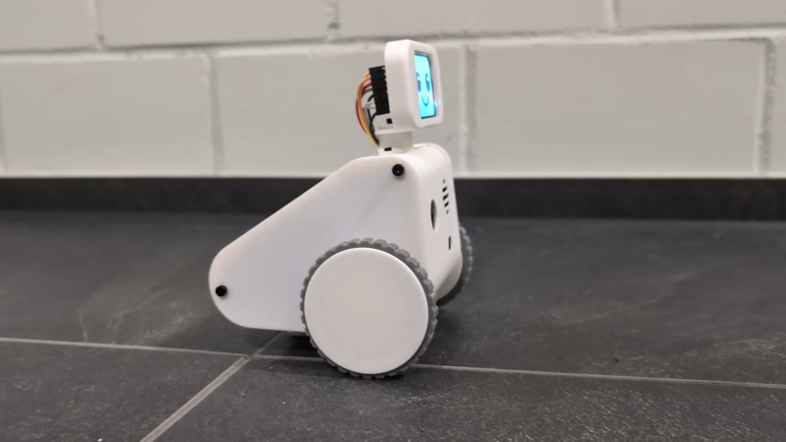

# 6. Calibrate and test Robbi



[Guide home](README.md) · [← Assembly](05-assembly.md) · [Troubleshooting →](07-troubleshooting.md)

Do this with the confirmed PCB wiring, motor supply checks and software pin mapping complete. The original robot's measurements are starting estimates, not calibration values for every printed robot.

## 1. Calibrate the IMU

Complete the final wiring and fitting checks before powering up. Open the dashboard's **IMU** tab and follow its calibration procedure in the order shown. Keep motor output disabled during this step.

When calibration is complete, gently rotate the robot by hand and check that the orientation responds correctly and settles when held still. Record the result before moving on to wheel tests.



*The illustration shows an older dashboard design. Use the **IMU** tab and its calibration instructions in your installed version.*

## 2. Inspect before enabling movement

1. Shut down and remove power. Reconnect the labelled motor/encoder leads, inspect polarity and look for anything near the wheel or encoder magnet.
2. Set **`hardware.right_encoder_b_pin: 16`** for the supplied PCB. The [wiring table](WIRING.md#right--mencoder_r) traces right encoder B to Pi physical pin 36 / BCM16. Use `7` only for an explicitly rewired repair; configure the field rather than editing the Python source.
3. Confirm the rear support foot is fitted, then support the body so both wheels are off the surface. Keep fingers and loose cables clear. Make the physical power cutoff immediately reachable.
4. Leave autonomy, heartbeat, daily tasks and servo outputs disabled. Keep the obstacle guard enabled for forward motion; place a clear target within the sensor's usable range if needed to obtain a valid sample.
5. With motor power disabled, observe the encoder counts while slowly rotating each wheel. Both A and B should change, and turning one wheel should affect only its own channel. Do not force a gearbox that resists back-driving; use the controlled raised-wheel test after wiring checks instead.

**Legacy tools:** `tools/legacy/encoder_probe.py` has an independent hard-coded repair map. Its `--pulse` option also commands 60% duty. Do not run it unchanged as a generic new-build test. Use a release-matched diagnostic or the runtime's motion diagnostics. Stop the runtime before any independent tool claims GPIO.

## 3. First powered wheel tests

The runtime requires both `runtime.calibration_confirmed: true` and `hardware.enable_motors: true` before it permits motor output. The first flag is a manual acknowledgement, **not** evidence that software has measured calibration automatically. Enable the two flags only after the preceding wiring, pin ownership, supply and raised-wheel checks; finish the measurements below before floor operation.

Keep the supplied conservative PWM caps initially. A duty cap alone does not make an incompatible supply safe. If the motor does not start, stop and investigate friction, voltage and the appropriate duty range rather than leaving it stalled.

1. Apply one short, bounded left-wheel command, around 200–300 ms, at a verified low duty. Stop completely.
2. Confirm physical forward direction and positive logical forward counts. Repeat for the right wheel.
3. If the motor direction is wrong, check its wiring and the runtime's `motion.left_motor_invert` / `motion.right_motor_invert` settings. If encoder counts have the wrong sign, use the corresponding `motion.encoder_left_invert` / `motion.encoder_right_invert` setting after checking A/B wiring.
4. If the left command moves the right wheel, fix the side assignment. Do not hide an accidental harness swap behind several simultaneous inversion changes.
5. Repeat both directions and use Stop during a short command. A wheel that continues running, has no encoder feedback or starts unexpectedly is a failed test.

Record which setting you changed and repeat the same test. Change one variable at a time.

## 4. Measure wheel travel

Measure the outside diameter of the **finished rolling surface**, including its tread, and the distance between wheel contact centre lines. Enter dimensions in **centimetres** for `motion.wheel_diameter_cm` and `motion.wheel_base_cm`.

Measure counts over several exact wheel revolutions, then divide by the number of revolutions. `motion.encoder_counts_per_rev` must mean decoded counts per **output-wheel** revolution, including the gearbox and the software's quadrature counting convention. The seller's motor-shaft pulse count is not necessarily that number.

The prototype profile uses 6.2 cm diameter and 2800 counts/revolution. Its effective turn spacing has been adjusted between recorded builds. Re-measure instead of inheriting those values silently.

## 5. Straight-line checks on the floor



1. Use a clear, level floor away from stairs. Check that the two wheels and rounded rear support foot support the body with the shell clear of the floor. Mark the start position of a fixed reference point on the robot, such as the axle centre line.
2. Start with a 10 cm forward move at low speed. Check direction, stop behaviour and approximate distance.
3. Increase to 50 cm, then 100 cm after the shorter move is reliable. Measure from the same reference point after the robot has stopped.
4. Repeat at least three times and record forward distance and sideways drift. Test reverse travel separately with the space behind Robbi clear.

If every run travels approximately the same proportion too far or too short, check wheel diameter and counts-per-revolution. If changing **only** effective wheel diameter for a systematic distance error:

`new diameter = old diameter × commanded distance / measured distance`

For example, a commanded 100 cm that repeatedly travels 90 cm suggests multiplying the current diameter by `100/90`, provided slip, counting errors and units have already been excluded. Do not adjust diameter and counts-per-revolution at the same time. A path that curves points first to wheel drag, mismatched tread, missed counts or side mapping, not just a global distance scale.

## 6. Turning checks

Mark the starting heading on the floor and test left/right 90° turns, then 180° and a full revolution. Let each turn settle before measuring. Repeat in both directions.

Confirm the straight-distance calibration first. Adjust effective wheelbase only when the observed error is repeatable and wheel slip/encoder problems have been excluded. If the active controller uses IMU feedback or a separate turn gain, inspect that control mode before applying an odometry-only correction; do not tune several mechanisms to compensate for one another.

**Checkpoint:** turns are repeatable in both directions, neither wheel loses counts, and Stop works throughout. Record the measured error; “looks roughly right” is not a calibration result.

## 7. Sensors and interruption tests

With a soft obstacle and room to stop, verify the forward range guard at low speed. A configured 12 cm threshold is a starting setting, not proof that stopping distance is adequate at every speed.

Verify that stale or missing forward range blocks forward motion. Disconnect sensors only with power off; restart and inspect the expected fault before attempting a supervised check. The absence of a second ToF means there is no validated cliff detection. Keep all floor tests away from edges.

During a short finite movement, interrupt the network and verify that the command expires and does not resume when the connection returns. Test the physical cutoff separately. Confirm the robot recovers to a stopped state after restart.

## 8. Recheck the finished assembly

1. Shut Linux down, switch off and remove the cell.
2. Dress the wires into the body. Preserve the head's service loop; keep the camera ribbon away from screw tips and sharp folds.
3. Check each panel is seated without force. If a gap remains, reopen it and find the obstruction instead of tightening harder. Protect the camera ribbon when refitting the back panel.
4. Turn each wheel and move the head by hand again. Check the power switch, charging/battery access and microSD access.
5. Reinstall the battery, power on, and repeat the face, camera, microphone, speaker, sensor and short motion checks. A fault that appears only after closing is often a pinched lead or shifted connector.



Complete [the build record](build-record.csv), save your final configuration and package versions, and keep a backup of the working SD card. Enable autonomous features individually only after manual movement and sensing are reliable. Room-scale navigation and a kitchen-and-back demonstration require their own testing; assembling the hardware does not establish that level of accuracy.

## 9. Test STT, LLM and TTS

Hardware checks do not yet prove the complete conversation works. Configure your own providers, then check each part separately.

| Check | Try this | Pass condition |
| :--- | :--- | :--- |
| **STT — speech to text** | Say a short sentence into the microphone. | The transcription matches what you said. |
| **LLM — language model** | Send a simple question through typed chat. | Robbi produces a relevant, coherent answer. |
| **TTS — text to speech** | Play a short response through the speaker. | The voice is understandable and free of obvious clipping or distortion. |
| **Full conversation** | Ask aloud, wait for the reply and follow up. | Listening, transcription, response and speech work together. |

Run `robbi-setup` if you skipped provider setup or want to change keys. The wizard stores your own keys in the runtime’s `.env.secrets` with owner-only permissions and leaves calibrated geometry intact. Dashboard **Settings → Connections & API keys** also saves provider keys, accepts custom model IDs and local/OpenAI-compatible endpoints, discovers models and tests the connection. Select Tavily there to enable current web/news lookup. Choose a model and, for ElevenLabs, a voice available to your own account. No helper server is installed on the Pi.

After the individual checks above pass, set `voice.enabled: true` with `wake_engine: local_wake`, and enrol your own examples in the **Wake word** tab: at least four positives, three negatives and two noise clips, then run browser calibration and review the result before applying it. Record a few natural examples at the intended speaking distance. Check recognition and false triggers before leaving listening enabled. Keep autonomy, Telegram and proactive tasks off until basic interaction works.


## 10. Verify automatic startup

The installer already creates and enables `robbi-v2.service` for your Linux account, using the same `config/robot.yaml` you calibrated. No service template or profile switch is needed.

```sh
sudo systemctl restart robbi-v2.service
systemctl status robbi-v2.service --no-pager
journalctl -u robbi-v2.service -n 80 --no-pager
```

Test a reboot and confirm the dashboard, settings and peripherals recover. Do not leave a foreground instance running alongside the service. The motor-disable helper assumes enable on BCM26 and supplements a reachable physical cutoff.

To stop automatic startup: `sudo systemctl disable --now robbi-v2.service`. To restore it: `sudo systemctl enable --now robbi-v2.service`. Back up your working configuration, private secret file and `var/` to a private location after calibration.
