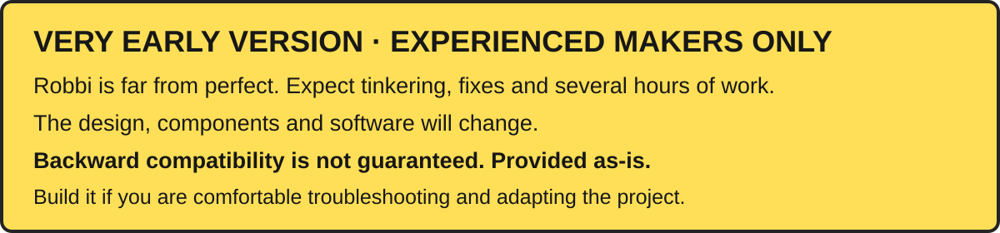
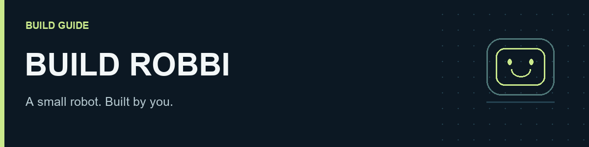
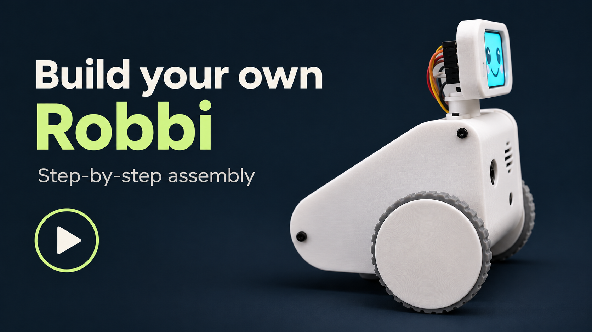

# Build Robbi





A small Raspberry Pi robot with a face, a camera, a voice and two encoder-equipped wheels. Build the electronics on the bench, fit them into the printed body, then bring Robbi's movement and conversation to life.

## Software and first setup

The reusable runtime is in [`software/`](../software/README.md). It includes the full generic app library, generated expressions and media, voice conversations and memory, provider configuration, manual control, IMU visualization and experimental mapping. Owner data, keys, captured photos, private training workflows and the Filming dashboard are excluded.

Start with the **[complete first-install walkthrough](../software/SETUP.md)**. Once the Pi is reachable by SSH:

```sh
curl --proto '=https' --tlsv1.2 -fsSL https://raw.githubusercontent.com/ace-builder/Robbi/main/software/install.sh | bash
```

The terminal wizard handles your own API keys, model and voice choice, dashboard password, Wi-Fi and optional Telegram. Normal operation then moves to the dashboard. See [licensing](../software/LICENSE.md): personal non-commercial use and modification are welcome; commercial permission is separate.

## Watch the build

[](https://youtu.be/MBummcW5DIk)

**11:46 · 4K · silent, with on-screen instructions.** Follow the assembly in the video and use the written steps below for parts, wiring and calibration.

[Bench tests](https://youtu.be/MBummcW5DIk?t=59) · [Motors and wheels](https://youtu.be/MBummcW5DIk?t=136) · [Head assembly](https://youtu.be/MBummcW5DIk?t=305) · [Final checks](https://youtu.be/MBummcW5DIk?t=626)

> [!IMPORTANT]
> **Build guide in progress.** Includes the parts and variant photos, manufactured PCB settings, connector pinout, assembly STL and illustrated build sequence. Remaining gaps are the tested print recipe, exact fasteners at each mounting point, motor-cable identification and measured power/load limits. See the [release checklist](RELEASE-CHECKLIST.md).

## Start here

Follow the order below. **Finish the bench tests before mounting the electronics in the shell.**

| Step | What you will do |
| :--- | :--- |
| **[01 · Parts](01-parts.md)** | Order the matching board, modules, motors and hardware. |
| **[02 · Preparation](02-preparation.md)** | Gather tools, prepare printed parts and check the fits. |
| **[03 · Software](03-software.md)** | Flash Bookworm, run one installer command and finish in the dashboard. |
| **[04 · Bench tests](04-bench-tests.md)** | Test the battery-powered bare PCB, join it to the Pi, then check the peripherals. |
| **[05 · Assembly](05-assembly.md)** | Mount the motors, Pi/back panel and head; fit the wiring, ToF sensor and side-panel inserts. |
| **[06 · Calibration](06-calibration.md)** | Follow IMU calibration, check wheel movement and test STT, LLM and TTS. |
| **[Troubleshooting](07-troubleshooting.md)** | Isolate a fault without changing several things at once. |

## What you are building

| Core | Hardware |
| :--- | :--- |
| Computer | Raspberry Pi Zero 2 W with a soldered 40-pin header |
| Main board | Custom `Robbi 2026-09` PCB: power circuit, motor driver, speaker amplifier and IMU |
| Movement | Two matching 3 V / 75 RPM N20 motors with encoders |
| Face and voice | 1.69-inch SPI display, USB microphone and miniature speaker |
| Vision and distance | IMX219 camera and one forward-facing VL53L1X-family ToF module |

The second ToF connector and servo outputs are unused in this build. Use the PCB and print revisions listed in this guide together.

## Known limitations

Read the [current prototype limitations](../README.md#known-limitations) before ordering parts or starting assembly.

## Keep these nearby

- **[Parts list](bom.csv)** — quantities, variants and purchase links.
- **[Wiring reference](WIRING.md)** — top-view connector drawing, numbered pins, display power-pin swap and power test points.
- **[Build record](build-record.csv)** — record your revisions, measurements and test results.
- **[PCB manufacturing files](hardware/pcb/README.md)** and **[enclosure model](hardware/prints/README.md)**.
- **[One-command installation](03-software.md)** — minimal terminal setup, automatic startup and one generated configuration.
- **[Release readiness](RELEASE-CHECKLIST.md)** — runtime publication and fresh-card testing status.

> [!TIP]
> Keep power disconnected while changing wiring or fitting parts. For the first powered motor checks, raise both wheels. Floor tests need a clear, level area away from edges: the forward ToF sensor does not provide cliff detection.

## Repository layout

This guide, its images and manufacturing files live together under `build/`. The reusable runtime, installer and software documentation live under [`software/`](../software/README.md). Start with the [project overview](../README.md) for the complete setup sequence.
