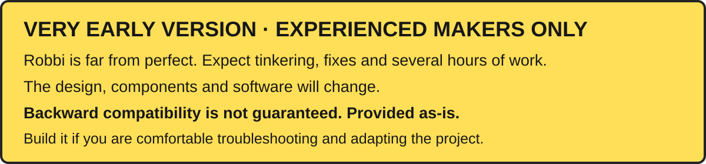

# Robbi software

Robbi's modular Raspberry Pi Zero 2 W runtime, packaged separately from owner data. Start with the [project overview](../README.md), [guided installation](SETUP.md) and the [hardware build guide](../build/README.md). The installer in `software/install.sh` works directly from the published source snapshot; no separately created GitHub Release is needed.

The runtime includes configurable LLM/STT/TTS providers, follow-up conversation, persistent memory and mood, background tasks, camera and media tools, live IMU visualization, manual motion, experimental Map & Explore, and 40 generic standalone apps. Apps use the robot API and owner-approved permissions; downloaded apps use the existing isolation boundary. The Robbi App Hub client defaults to `https://ai-tier.com/apphub` and its URL is configurable. The Hub website/server is not bundled.

Fresh installations contain no keys, owner profiles, memories, conversations, camera captures, maps, voice enrollment or saved app data. The public dashboard has no Filming tab or private LLM training recorder. Generic personality templates are in `templates/`; owner overrides and all generated state are created in `var/`. Credentials are created in `.env.secrets` on the target machine, never in the repository.

## Project layout

| Folder | Purpose |
| --- | --- |
| `src/` | Runtime, hardware adapters, orchestration and reusable services. |
| `apps/` | All 40 standalone bundled apps, including their manifests and artwork. |
| `web/` | Local dashboard and App Hub client. |
| `templates/` | Generic character instructions and built-in workflow templates. |
| `assets/`, `animations/` | Reviewed graphics, sprites, sounds and animation recipes. |
| `tools/` | Grouped development, account, hardware and release utilities. |
| `tests/` | Offline maintainer regression tests, excluded from the Pi install. |

For development, use Python 3.11/3.12 in a virtual environment and run `python -m pip install -e '.[test,providers]'` followed by `python -m pytest`. See [app development](docs/apps/APP_DEVELOPMENT.md), [architecture](docs/development/ARCHITECTURE.md), [media credits](docs/MEDIA.md) and [release review](docs/development/RELEASING.md).

First-party code uses [PolyForm Noncommercial 1.0.0](LICENSE). Hardware, documentation and first-party artwork have the separate terms described in [repository licensing](LICENSE.md). Third-party licences remain intact. This is source-available, not an OSI open-source release.
