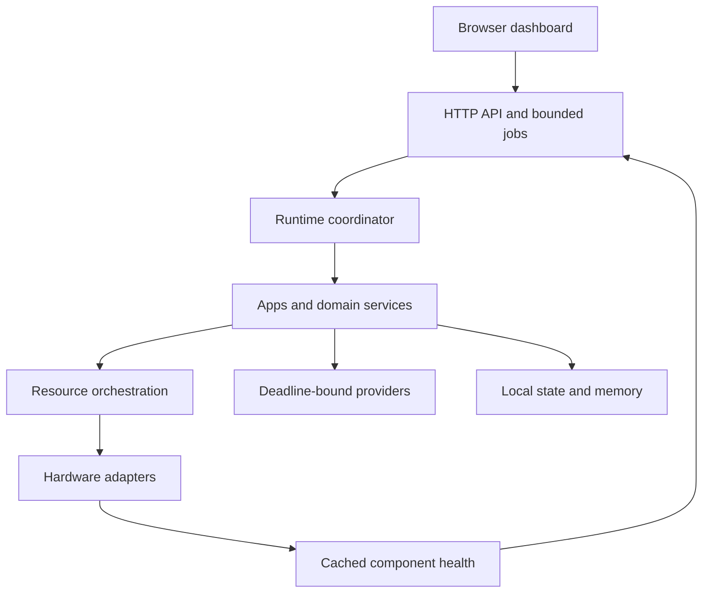
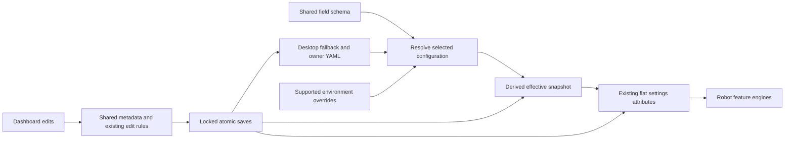

# Robbi architecture

Robbi uses one main Python process, disposable isolated workers for imported apps, bounded work queues and a small Flask/Waitress HTTP boundary. The browser renders the dashboard and 3D views; the Pi owns the devices. Language/speech inference runs through configurable cloud or external-machine providers.

## Responsibilities

| Layer | Location | Owns |
| --- | --- | --- |
| Runtime | `src/robbi/runtime.py`, config, jobs, health | Startup, lifecycle, bounded jobs and cached diagnostics |
| Domain engines | `src/robbi/engine/domains/`, feature modules | Conversation, presentation, motion and integration |
| Services | `src/robbi/services/` | Conversation/background work, day cycle and productivity |
| App platform | `src/robbi/app_runtime/`, `apps/` | Portable projects, SDK, permissions, tools, app dashboards and private per-installation state |
| Hardware | Optional camera, LCD, audio, motor, ToF and IMU adapters | Single device ownership, cached sensor state and health |
| Navigation | `src/robbi/navigation/` | Local occupancy mapping, measured pose, scan coverage, localization and path planning |
| Presentation tools | Audio Studio, Motion Studio | Reviewable media generation and coordinated action timing |
| Setup | `src/robbi/setup/`, `install.sh` | Fresh-install checks, terminal wizard, generated configuration/service |

The controller still contains domain mixins and shared integration state. This is a deliberate compatibility boundary, not a claim that every old feature is fully independent. Add new reusable behavior in a service or standalone app, with injected device/storage/provider ports, and keep controller methods small.

## Startup and failure containment

Validate YAML before optional device imports. Expose HTTP health early, initialize independent components separately, and report unavailable/disabled/failed components honestly. A missing camera, key or sensor must not prevent access to diagnostics. Bound queue sizes, I/O timeouts, retries, image decoding and cache sizes. Stop and cancellation bypass occupied feature-request slots; stale actions must not replay after recovery.

Status uses cached snapshots, with separate fast device, slower database-summary and asset-catalog intervals. Large image/model work runs outside HTTP workers. Camera consumers share captures instead of opening competing devices. CPU-heavy authoring and model work belongs on the development computer, not the Zero 2 W.

## Ownership and permissions

Sensor snapshots are shared reads. Display, audio, camera capture and movement request resource ownership with priorities, cancellation and expiry. Related app actions can form a session to preserve coordination. Only one motor command owns the wheels at a time. Apps declare capabilities; the owner grants consent once, with saved decisions and an explicit development bypass. See [permissions](../apps/APP_PERMISSIONS.md) and [orchestration](HARDWARE_ORCHESTRATION.md).

Bundled apps and separately installed event extensions remain trusted host code. Imported App Hub/ZIP apps run in OS isolation and access capabilities through the checked SDK broker. App dashboard pages have a separate browser boundary. Remote providers receive only the inputs selected for their requested features.

## Configuration and data

The installer generates `config/robot.yaml`; `config/desktop.yaml` provides conservative fallback defaults. Board pin ownership is centralized, including the configurable right-encoder input. Calibration belongs to the individual installation, never a copied prototype profile. Secrets are injected from the local `.env.secrets`; generated state goes to `var/`. Neither is a repository/release input.

New public installations have empty memory, conversations, maps, app data and voice enrollment. The private training collector is absent. [Optional event extensions](EVENT_EXTENSIONS.md) provide an explicit installed-package boundary with no default capture, workers or media copies. [Public/private development](PUBLIC_PRIVATE.md) describes repository separation.

## Movement and navigation

Wheel encoders and IMU heading inform movement and pose; accelerometer data supports orientation and stillness checks. Mapping uses measured ray headings and validates angular coverage. A scan-only small final-angle miss may be accepted when the completed turn and heading are usable; navigation does not snap the pose to a requested angle. Missing/stale required sensors, cancellation and real motion faults remain separate outcomes.

Map & Explore is experimental sparse range mapping, not guaranteed apartment-wide SLAM. A single forward ToF cannot see cliffs or every surface, and relocation can be ambiguous. Physical stop, calibration and supervised tests remain necessary.

## Extension and verification contracts

Apps are standalone projects with manifests, tool descriptions, trigger examples, validated arguments, per-installation settings/state and optional dashboards. Shared provider adapters are configurable. See [app development](../apps/APP_DEVELOPMENT.md), [portable packages](../apps/APP_PACKAGES.md) and [providers](../apps/APP_PROVIDERS.md).

Test missing hardware, invalid configuration, unavailable providers, cancellation/backpressure, corrupt media, permission decisions and empty-state startup. Desktop tests establish behavior, not physical calibration or Pi performance. The [installation guide](../INSTALL.md) and [release procedure](RELEASING.md) define the remaining fresh-card and physical checks.

Current setup and isolation contract: [security and review notes](../security-and-review.txt). Imported apps cannot bypass OS isolation with the SDK development permission switch.

## Shared configuration and package layout

The active runtime is one `robbi` package. Existing feature implementations live
under `robbi.engine`; control loops, providers, media processing and domain
methods retain their existing implementations. `robot` is a lazy compatibility
namespace for older apps and maintenance scripts. It aliases the same module
objects, including the same settings singleton, rather than importing a second
copy. Runtime code imports the canonical modules directly.

| Module | Responsibility |
| --- | --- |
| `robbi.configuration.schema` | Canonical field defaults, YAML paths, environment names, types, aliases, bounds and editor metadata; no I/O |
| `robbi.configuration.autonomy` | Existing day-cycle/background-work field definitions and cross-field rules, included in the shared schema |
| `robbi.configuration.resolution` | Resolve aliases, profile values and environment overrides into the existing typed settings attributes |
| `robbi.configuration.store` | Bounded YAML parsing, full-file validation, profile merge, effective snapshot and atomic persistence |
| `robbi.configuration.settings` | Flat engine settings adapter, per-installation paths and existing live-edit entrypoints |
| `robbi.configuration.view` | Existing dashboard settings response shape and model suggestions |
| `robbi.configuration.secrets` | One private environment-file parser for CLI, setup and the engine adapter |
| `robbi.config` / `robot.config` | Compatibility imports for the store / engine settings adapter |

The owner still edits `config/robot.yaml` (or the explicitly selected YAML).
`var/effective.yaml` is a derived handoff/cache, not a second user configuration.
Schema defaults are generic fallbacks. The desktop fallback and installer robot
profile deliberately override them for their different startup policies; they
are not competing field schemas. No stored calibration or personal file needs
migration.

Existing environment names and provider/model aliases continue to work.
Credentials stay out of the effective YAML. Selected-profile capture, messaging
and motor-enable flags continue to override inherited environment flags. The CLI
loads private environment values before resolving the runtime snapshot so the
HTTP/runtime and engine views agree. Validation-only startup does not load keys
or initialize hardware.

Supported form edits retain their existing validation and component reloads.
A shared write lock covers the configuration store and live adapter. Saved source
and effective-cache writes finish before live attributes change; if writing the
source fails, the cache is restored and live values remain unchanged. Full-file
edits remain restart-required. Partial form edits preserve unrelated fields,
including existing extensions, and retain the existing stricter pair checks for
edited motor/ToF ranges. This cleanup adds no new motion gates and does not reject
previously supported startup profiles solely because the motor controller caps
a configured minimum at a lower maximum.

To add a setting, declare its existing-style attribute and metadata in the shared
schema (or the autonomous domain definition). Numeric constraints and editable
bindings derive from that declaration. Add its presentation to `view.py` when a
form control is appropriate; reuse the controller's existing reload hook. Keep
hardware/provider imports out of the configuration layer. New reusable behavior
belongs in services or apps, with small engine integration methods.

Tests cover alias identity, import isolation, old/new profile parity, credential
separation, failed-save rollback, saved/live/restart consistency and the existing
feature regressions. Desktop tests do not certify physical Pi timing or sensor
calibration. Deployment remains a separate acceptance step.

## Runtime worker and recovery contracts

`robbi.execution` owns the existing bounded worker implementation, independent
of HTTP job history in `robbi.jobs`. Feature lanes in `robbi.resources` continue
to share the global admission budget. The old `robbi.jobs.BoundedExecutor`
import remains an alias for existing integrations. Workers are lazy daemons;
shutdown cancels queued work without claiming to kill an in-flight native call.

Admission is transactional: a worker-start failure releases capacity and never
queues the rejected action. Idle workers discard references to completed input,
results and exception frames, so large media/request objects can be reclaimed.
Pending cancellation and shutdown retain their existing queue accounting and
nonblocking behavior. Concurrency counts must be finite integer counts.

Runtime shutdown attempts every component even when an earlier close fails.
Failures remain visible in component health and local logs; a failed optional
service cannot skip controller shutdown or the final event/recording sink.
This isolation handles exceptions, not indefinitely blocked native drivers.

Configuration and private environment files use the shared bounded binary
reader in `robbi.storage` before UTF-8 decoding and parsing. YAML parser depth
failures become actionable configuration errors and preserve the source file.
The existing conservative recovery profile keeps diagnostics available.
Conditional HTTP cache hits honor the caller's cancellation/deadline before
returning cached-response metadata. Existing response cleanup is retained.

## Background task persistence and stop boundaries

Admission stages a bounded retention map and commits the new task plus pruning
in one SQLite transaction before replacing live history. A failed save leaves
existing results and delivery owners intact. Successful work owns a detached
copy of its already validated JSON; a provider cannot mutate stored/delivered
results later through a shared dictionary. Existing size/history limits remain.

Permanent shutdown marks the service closed and signals its current cancellation
epoch under the same short lock used to capture admission. It does not rotate
to a fresh epoch or wait for storage. Ordinary Stop can still rotate the epoch
to cancel existing actions while permitting later explicit requests. Workers
check their captured epoch before entering provider work.

Every Future completion reconciles cancellation or an abnormal worker exit with
a terminal task/job state. Unexpected worker failures are retained with a safe
error category, without announcing a successful result. A failed final write
releases active admission and reports the storage problem; restart recovery
still never replays interrupted work.

Runtime shutdown resolves each optional adapter and method inside its individual
failure boundary. Missing adapters are skipped; missing/failing close methods
are reported without skipping emergency stop or subsequent cleanup.
